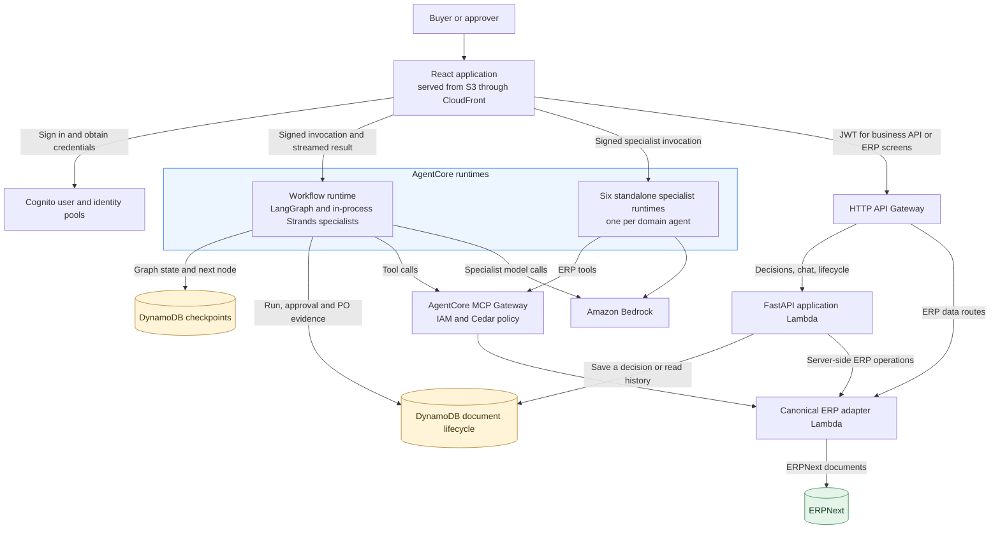
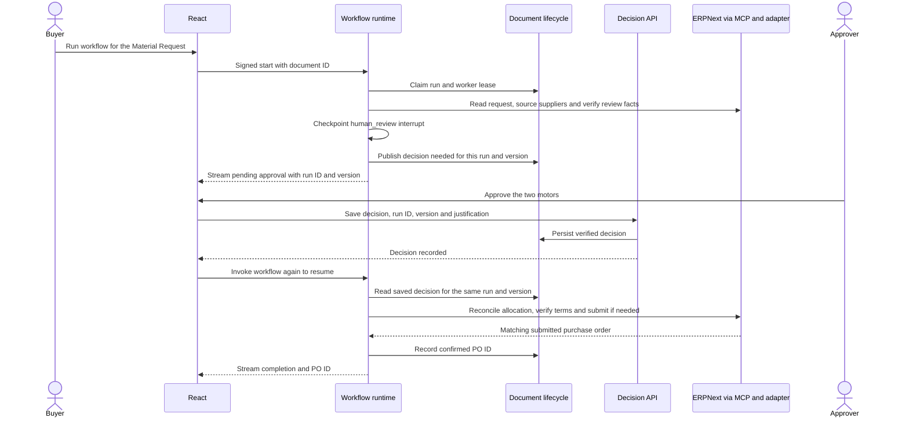
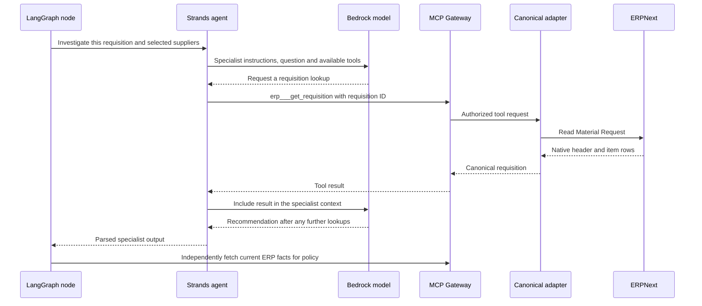
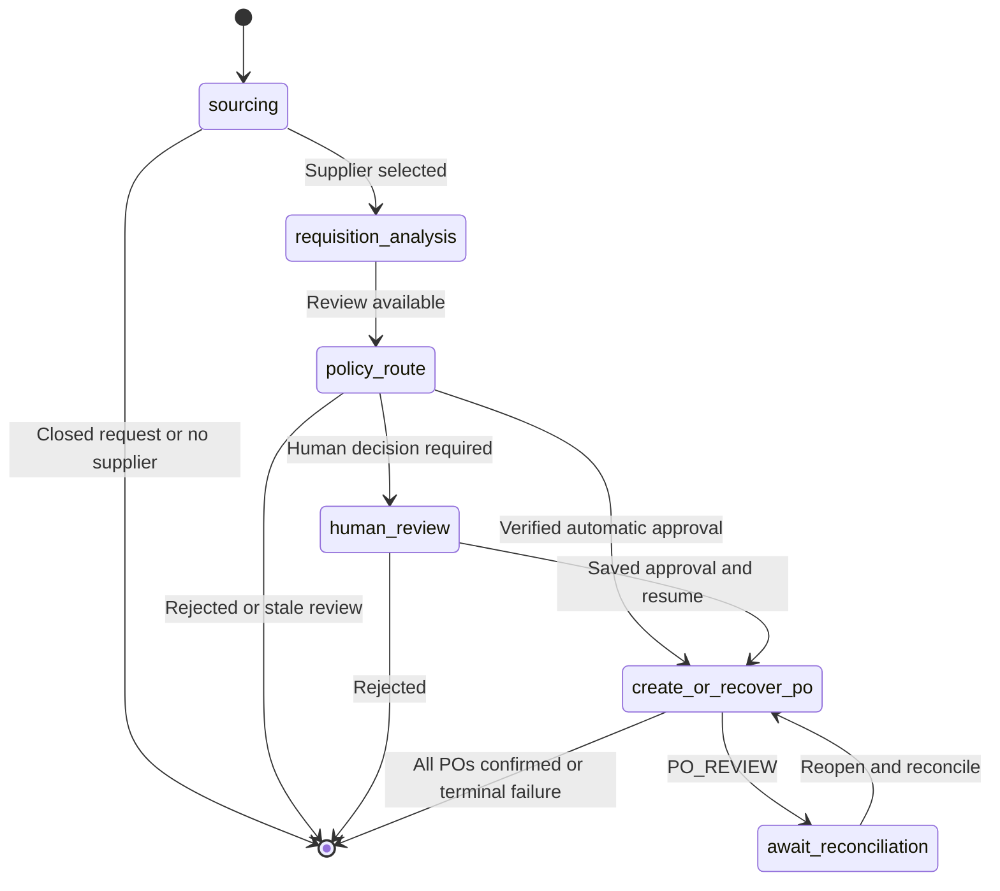
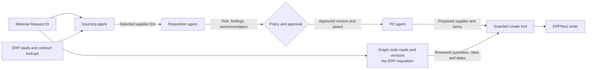
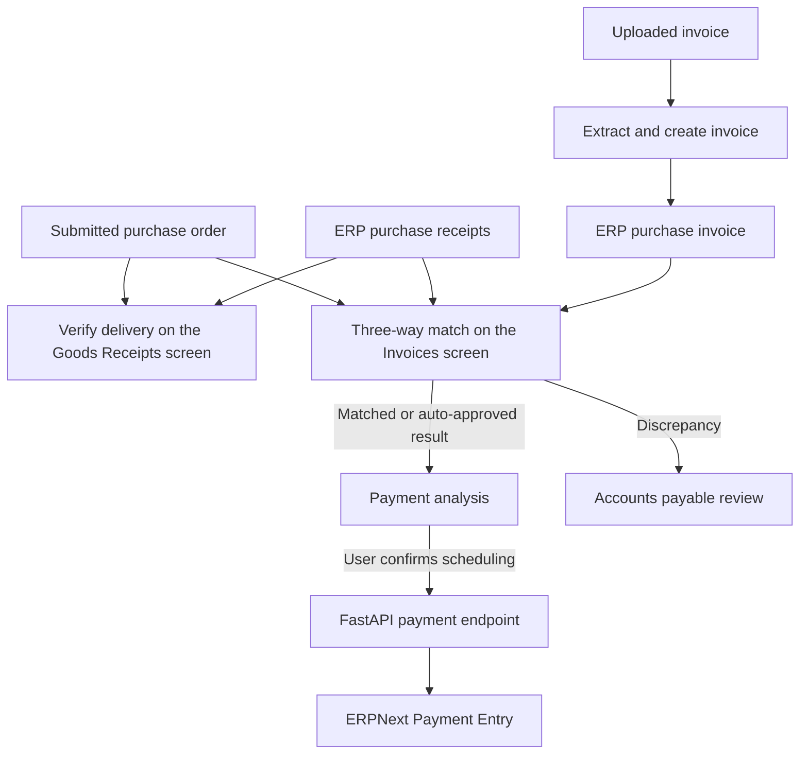
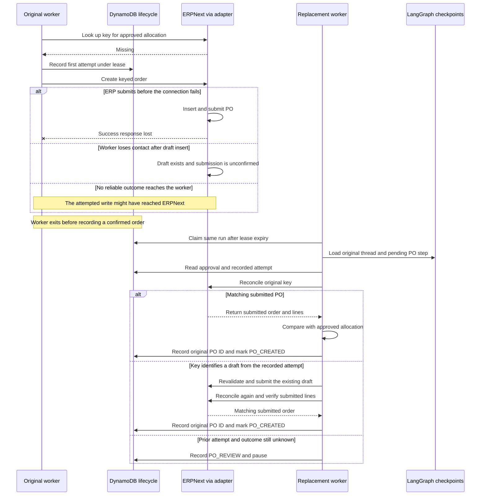
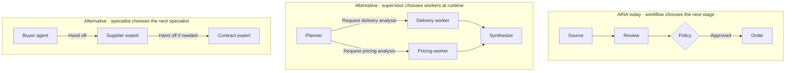

# ARIA procure-to-pay with LangGraph

A buyer requests two lift motors at $4,000 each. Which supplier should supply them? Who can authorize the $8,000 purchase? If ERPNext creates the order and the worker loses the response, what should the buyer see when they reopen the request?

ARIA assigns those questions to different components. **LangGraph owns the sequence of work. Strands agents use a Bedrock model to investigate and propose actions. The decision API records human authority, and ERPNext establishes whether an order exists.** The full requisition workflow succeeds when ARIA can identify the submitted purchase order for every approved supplier allocation. Receiving, invoice matching, payment and chat have their own entry points. For the wider platform layout, see the [original system architecture](ARCHITECTURE.md).

| Explore | What to look for |
|---|---|
| [1. System architecture](#1-system-architecture) | Which components run together and where data crosses a boundary |
| [2. Request and tool data flows](#2-request-and-tool-data-flows) | What travels between the browser, workflow, model and ERP |
| [3. The requisition state graph](#3-the-requisition-state-graph) | Six nodes, three policy outcomes and two reasons to pause |
| [4. Workflow runtime and specialist agents](#4-workflow-runtime-and-specialist-agents) | How sourcing, requisition analysis and PO management cooperate |
| [5. Receiving, invoices, payment and chat](#5-receiving-invoices-payment-and-chat) | What happens after the order and how chat can start a requisition |
| [6. Durable execution and ERP recovery](#6-durable-execution-and-erp-recovery) | Checkpoint, decision and ERP example records for one purchase |
| [7. Agent architecture patterns](#7-agent-architecture-patterns) | Which patterns ARIA implements and how other designs would behave |
| [8. Running and observing the design](#8-running-and-observing-the-design) | Where to see progress, verify a decision or replay a failure |

## 1. System architecture

ERPNext calls the purchase requisition a **Material Request**. A **purchase order** (PO) is the resulting commitment to a supplier. In the diagrams, MCP stands for **Model Context Protocol**, the interface through which the runtime calls named ERP tools.



There are **seven configured AgentCore runtimes**. One runs the workflow. The other six expose sourcing, requisition analysis, PO management, receiving, invoice matching and payment individually. A new start or an actual resume invokes the workflow runtime, which constructs the necessary Strands agents in its own process. When **Run Full Workflow** opens an existing requisition, the UI can show a pending, completed or rejected result directly from the lifecycle record. Chat is another use of Strands and Bedrock, hosted by the application Lambda. [Requisition UI](../frontend/src/pages/Requisitions.tsx#L453) · [Runtime definitions](../infra/lib/p2p-agentic-stack.ts#L426) · [Workflow dispatch](../backend/agentcore_app.py#L234) · [Specialist construction](../backend/workflow/strands_runtime.py#L114) · [Chat entry point](../backend/api/agents.py#L29)

| Component | Responsibility | Example from the motor purchase |
|---|---|---|
| React and Cognito | Authenticate the user, invoke a workflow or specialist, display streamed progress and send a decision. | A buyer starts the run. An approver can later reopen the requisition and act on its saved review. |
| LangGraph in the workflow runtime | Hold typed execution state, select edges, checkpoint progress and resume pending work. | After the $8,000 review, the next node waits for a human decision. |
| Strands and Bedrock | Give a specialist its prompt, model and tools. Return tool results to the model and parse the final response for the calling node. | Sourcing can inspect supplier delivery history before it recommends a vendor. |
| MCP Gateway and canonical adapter | Authorize named tools, translate tool arguments into ERP operations and map ERP documents to the application's common data model. | A requisition lookup returns ERPNext’s Material Request as a requisition with line items and a currency. |
| FastAPI decision route and DynamoDB | Verify the approver, record the decision against a run and version, and expose lifecycle history to the UI. The graph has a separate checkpoint table. | Reopening the browser recovers the pending review. A recorded approval can be read by a different worker. |
| ERPNext | Own supplier, item, requisition, order, goods receipt, invoice and payment records. | A submitted PO with matching lines supplies the order ID shown to the buyer. |

The AWS entry points and the local substitutes appear in the infrastructure and harness definitions. The canonical interface is the boundary an additional ERP adapter would implement. ERPNext is the concrete adapter described here. [API routing](../infra/lib/p2p-agentic-stack.ts#L732) · [Browser runtime client](../frontend/src/agentcore.ts#L148) · [Adapter interface](../backend/adapters/erp_adapter_base.py) · [Local component map](../local/README.md#L13)

## 2. Request and tool data flows

### An $8,000 requisition from start to order



The deployed browser uses temporary Cognito identity-pool credentials to sign a direct runtime request and reads newline-delimited JSON events. Saving a decision travels through a different path, the JWT-protected `POST /api/decisions/` endpoint. A browser can disappear between the two calls. On reopening, the server can recover the saved decision and checkpoint. If the approver rejects the request, the decision API records rejection and the UI ends that flow there. [Streaming client](../frontend/src/agentcore.ts#L148) · [UI decision and resume](../frontend/src/pages/Requisitions.tsx#L539) · [Decision API](../backend/api/decisions.py#L155) · [Runtime resume handling](../backend/workflow/p2p_graph.py#L907)

### Inside a specialist tool call



The specialist can choose additional reads based on the first result. The policy node has a different job. Its code fetches the current requisition by ID and, for an automatic approval candidate, verifies the cost-center budget. This gives the graph a way to detect a plausible analysis built on the wrong amount. The browser’s ERP screens also read through the canonical adapter, using the HTTP API route. [Requisition read and mapping](../backend/adapters/erpnext/adapter.py#L143) · [Graph read](../backend/workflow/p2p_graph.py#L285) · [Budget verification](../backend/workflow/p2p_graph.py#L351) · [Direct ERP tool calls](../backend/workflow/strands_runtime.py#L91)

## 3. The requisition state graph



The six named boxes are the six registered nodes. LangGraph compiles them with a checkpointer and runs with synchronous durability. A run can wait in two places. At `human_review`, progress depends on a person deciding whether to buy. At `await_reconciliation`, the purchase already has approval and progress depends on establishing what ERPNext did. That return edge makes this a state graph with a cycle. [Graph and edges](../backend/workflow/p2p_graph.py#L780) · [Reconciliation interrupt](../backend/workflow/p2p_graph.py#L751) · [Stream and durability](../backend/workflow/p2p_graph.py#L933)

| Review evidence | Route | Consequence |
|---|---|---|
| No supplier, or the ERP request is already closed | End at sourcing | No PO step runs. The result carries the reason. |
| The requisition changed between sourcing and policy | End with `STALE_APPROVAL` | The user needs a review of the current version. |
| The specialist recommends `REJECT` on the current version | Record `AI_REJECTED` and end | The workflow preserves the analysis and rejection. |
| `APPROVE`, low or medium risk, and verified financial evidence | Record `AI_APPROVED` and enter PO processing | The supported line amounts sum to at most the header total. The total is positive, in USD and at most $5,000. Exactly one matching cost-center budget in that currency covers it. Conflicting reported monetary or budget facts can still force review. |
| A current, non-rejected purchase falls outside those conditions | Publish `PENDING_APPROVAL` after the checkpoint | The two $4,000 motors take this route even if the model recommends approval and the budget covers the purchase. |

Approval also has an identity boundary. In the AWS path, the decision API reads the verified JWT role and accepts `approver`, `procurement` or `admin`. The gateway receives IAM principals for runtime tool calls. Its Cedar permissions and the graph’s purchase checks operate at different boundaries. In particular, the version and amount checks above run in application code. [Decision authorization](../backend/api/decisions.py#L199) · [Gateway configuration](../infra/lib/p2p-agentic-stack.ts#L291) · [Gateway tool permissions](../infra/policies/p2p-procurement.cedar#L11) · [Routing implementation](../backend/workflow/p2p_graph.py#L373)

---

## 4. Workflow runtime and specialist agents

| Role | Where it runs | What the caller receives |
|---|---|---|
| [Workflow coordinator](#workflow-coordinator) | `workflow` AgentCore runtime | The state of the purchase, the next human action or the confirmed order IDs |
| [Sourcing](#sourcing) | In the graph or the `sourcing` runtime | Supplier recommendation and optional item allocation |
| [Requisition analysis](#requisition-analysis) | In the graph or the `requisition` runtime | Findings, risk and an approval recommendation |
| [PO management](#po-management) | In the graph or the `po_management` runtime | On the graph path, one confirmed ERP order per approved allocation |
| [Receiving](#receiving-agent) | `receiving` runtime | Quantities received and outstanding, with delivery or inspection flags |
| [Invoice matching](#invoice-intake-and-matching-agent) | `invoice_matching` runtime | Comparison of invoice, purchase order and goods receipts |
| [Payment](#payment-agent-and-the-posting-boundary) | `payment` runtime | Payment recommendation, discount opportunity or reason to hold |
| [Chat](#chat-agent-and-memory) | FastAPI application Lambda | A conversational answer or the result of a requested ERP action |

### Workflow coordinator

The AgentCore entry point selects the execution path with `AGENT_NAME`. For `workflow`, it opens the DynamoDB checkpointer and creates a `StrandsWorkflowRuntime`. LangGraph invokes each specialist inside that runtime using the configured Bedrock model, an agent-specific system prompt, the MCP client and any local tools for that specialist. The coordinator has no planner model of its own. Its input is a document ID and a start or resume action. Its output is a stream of progress and the current business outcome. [Entry point](../backend/agentcore_app.py#L234) · [Workflow construction](../backend/agentcore_app.py#L446) · [Strands tool and model calls](../backend/workflow/strands_runtime.py#L91)



### Sourcing

**Trigger and input.** The first graph node takes a Material Request ID and reads its ERP snapshot. A closed request stops before model invocation. With an open request, the specialist examines active suppliers, prior purchase orders and receipts, supplier performance, and locally provided contract lookups. The prompt assigns 35% to price, 30% to delivery, 20% to quality and 15% to capacity. These weights guide the model’s assessment. [Node](../backend/workflow/p2p_graph.py#L302) · [Scoring and tool instructions](../backend/agents/sourcing_agent.py#L38) · [Local contract tools](../backend/agentcore_app.py#L54)

**Output and handoff.** Sourcing returns a recommended supplier, score, supporting evaluations and an optional split award. The graph normalizes the supplier identifier, saves the analysis and retains the ERP snapshot and its version. The next prompt receives the selected supplier IDs. A missing selection ends the run as `NO_VENDOR`. For a split award, each item must belong to exactly one supplier and the allocations must cover the reviewed request. [Output format](../backend/agents/sourcing_agent.py#L85) · [Supplier normalization and allocation validation](../backend/workflow/p2p_graph.py#L119)

### Requisition analysis

**Trigger and input.** After sourcing succeeds, the requisition specialist receives the Material Request ID and the supplier IDs. It checks catalog items, duplicate requests, historical prices, budget signals and supplier reliability. Its JSON response carries `recommendation`, `risk_level`, `confidence`, `findings` and the reported total. [Graph invocation](../backend/workflow/p2p_graph.py#L329) · [Review contract](../backend/agents/requisition_agent.py#L92)

**Output and handoff.** The graph re-reads the requisition before routing and checks its version. Policy takes the amount and currency from ERPNext. For example, one fixture has the model report $3,250 for motors that ERPNext values at $6,500. The graph uses the ERP total, appends a finding about the mismatch and routes to human review. [Underreported amount case](../backend/evals/requisitions.v1.json#L87) · [Threshold logic](../backend/agentcore_app.py#L206) · [Trusted data checks](../backend/workflow/p2p_graph.py#L373) · [Policy routes](../backend/workflow/p2p_graph.py#L438)

### PO management

**Trigger and input.** The PO node checks the saved approval against the run and request version, resolves the award, and looks for an existing ERP order per supplier. For a human approval it forwards the saved approver’s email to the ERP tools, including when a buyer reopens the run. In the AWS path, a missing approver email stops the write with `APPROVER_IDENTITY_REQUIRED`. On the new-order path, it gives the specialist the requisition ID and approved item assignment. The PO prompt supports checking supplier details, terms, blanket orders and draft orders. The workflow specifically requests one purchase order per approved supplier allocation. [PO prompt](../backend/agents/po_management_agent.py#L31) · [Approval and keys](../backend/workflow/p2p_graph.py#L473) · [Graph-specific instructions](../backend/workflow/p2p_graph.py#L691)

**Write and result.** PO tool calls run sequentially. Before creation, the hook checks the supplier, quantities and duplicate item rows. It replaces the proposed arguments with the reviewed commercial fields, adds the stable operation key and saves an attempt before the call leaves the worker. The graph derives `created_order_ids` and the total from confirmed ERP records. [Tool guard](../backend/workflow/strands_runtime.py#L41) · [Argument preparation](../backend/workflow/p2p_graph.py#L623) · [Result assembly](../backend/workflow/p2p_graph.py#L734)

### State and standalone execution

`WorkflowState` is a `TypedDict` with optional keys. Nodes return partial updates carrying identity (`document_id`, `run_id`, `request_version`), the reviewed ERP requisition, the three specialist payloads, and outcome or error information. The specialist payloads are dictionaries. Their fields are checked where the graph uses them, including supplier selection, allocation coverage and PO creation. The lifecycle record owns business decisions and confirmed order IDs. The checkpoint contains the execution state needed to resume. [State definition](../backend/workflow/p2p_graph.py#L47) · [Checkpoint configuration](../backend/workflow/p2p_graph.py#L61) · [Saved decision lookup](../backend/workflow/p2p_graph.py#L459)

The React requisition page can invoke a single requisition analysis or start the full workflow. A standalone invocation constructs its own Strands agent, streams progress and records analysis history. Its hook list and tool wiring differ from the workflow’s. In particular, a standalone PO specialist uses a prompt that supports creation, and the standalone constructor installs the progress hook only. The LangGraph path supplies the versioned approval and keyed-write guarantees. The generic standalone path can also attach Code Interpreter to eligible agents and report an optional Bedrock guardrail evaluation after the agent returns. [Optional tools](../backend/agentcore_app.py#L82) · [Guardrail result](../backend/agentcore_app.py#L419) · [UI invocations](../frontend/src/pages/Requisitions.tsx#L387) · [Standalone construction](../backend/agentcore_app.py#L290) · [Standalone run history](../backend/agentcore_app.py#L356) · [PO prompt](../backend/agents/po_management_agent.py#L115) · [Compiled graph](../backend/workflow/p2p_graph.py#L780)

---

## 5. Receiving, invoices, payment and chat

The requisition graph can finish with a submitted PO before either motor arrives. The warehouse then needs evidence of delivery, accounts payable needs to check the supplier’s bill, and treasury needs to decide when to pay. The application exposes separate entry points for these jobs. [Graph edges](../backend/workflow/p2p_graph.py#L781) · [Runtime inventory](../infra/lib/p2p-agentic-stack.ts#L426) · [Chat endpoint](../backend/api/agents.py#L29)



### Receiving agent

**Input and actions.** The warehouse user selects a goods receipt and invokes `receiving`. The screen sends its PO ID when available and falls back to the receipt ID otherwise. The prompt expects a PO ID. It instructs the agent to read the order, retrieve **all** associated receipts, sum quantities by item and compare posting dates against the expected delivery date. Optional inspection findings depend on item group and value. [Receiving screen](../frontend/src/pages/GoodsReceipts.tsx#L77) · [Receiving instructions](../backend/agents/receiving_agent.py#L36)

**Output and impact.** For two motors ordered and one received, the expected result is `PARTIAL`, with one unit still open. The requested output also includes line-level quantities, timing and inspection flags. Recording the physical goods receipt is a separate ERP operation. The CDK also defines a disabled-by-default receipt simulator for demos. [Receiving output](../backend/agents/receiving_agent.py#L62) · [Simulation schedule](../infra/lib/p2p-agentic-stack.ts#L1046)

### Invoice intake and matching agent

**Input and actions.** Matching starts from an ERP purchase invoice ID. For an uploaded invoice, the API can first launch a background extraction job, return a job ID, look up the referenced PO and create a purchase invoice through the adapter. Extraction uses Bedrock structured output and falls back to Textract on failure. If extraction returns no lines, the creation job substitutes lines from the PO. In that case, verifying the billed quantity requires checking the original supplier document. [Invoice job](../backend/api/invoices.py#L85) · [Extraction fallback](../backend/services/textract.py#L122) · [PO-line fallback](../backend/api/invoices.py#L223)

**Output and impact.** The matching prompt asks the model to compare invoice prices and quantities against PO lines and aggregated receipts, including partial deliveries. It requests `MATCHED`, `DISCREPANCY` or `ESCALATE`, with a per-line explanation. The 3% price tolerance and confidence criterion are instructions supplied to the model. In the invoices UI, either `auto_approved` or `MATCHED` starts a separate payment analysis. If both motors are billed before the second arrives, accounts payable has a specific line and receipt discrepancy to investigate. [Matching instructions](../backend/agents/invoice_matching_agent.py#L53) · [UI handoff](../frontend/src/pages/Invoices.tsx#L201)

### Payment agent and the posting boundary

**Input and actions.** The agent analyzes the invoice, payment terms and recent payments. It can return a recommended date, net amount, discount and flags, or recommend holding or escalating. Invoice matching and payment can use Code Interpreter if the runtime initializes it. Their standalone Strands agents receive the gateway client. The payment prompt describes a payment-creation tool, and the Cedar policy permits IAM agents to call it. This gives the standalone agent broader access than the scheduling screen’s analysis step requires. [Payment rules and result](../backend/agents/payment_agent.py#L51) · [Runtime tools](../backend/agentcore_app.py#L290) · [Cedar permissions](../infra/policies/p2p-procurement.cedar#L11)

**Output and impact.** In the scheduling UI, the user confirms a separate API call. The endpoint passes the payment to the adapter, then attempts to record a lifecycle entry with the supplied analyses. The adapter checks for existing invoice-linked entries, inserts a draft, submits it and rereads its ERP status. Its success condition is a posted ERP Payment Entry. A bank settlement or a future-dated dispatch would need separate evidence. This payment path has its own duplicate check and error handling. The PO graph’s keyed recovery contract applies to POs. [UI confirmation](../frontend/src/pages/Invoices.tsx#L277) · [Scheduling endpoint](../backend/api/invoices.py#L289) · [Posting and verification](../backend/adapters/erpnext/adapter.py#L797)

### Chat agent and memory

**Input and actions.** The React chat page sends a message, role context, session ID and recent history to `POST /api/agents/chat`. FastAPI runs a synchronous Strands/Bedrock agent and supplies the authenticated email and department to its ERP adapter tools. A requester can search the catalog, confirm quantity and create a Material Request. The requester prompt directs them to the Requisitions page to run the approval workflow. The chat status tool calls a separate ERP status endpoint. The graph’s human decision is recorded against the run and request version through the decision API. [Chat invocation](../backend/api/agents.py#L29) · [Requester instructions](../backend/agents/chat_agent.py#L47) · [Status tool](../backend/agents/chat_agent.py#L222) · [Versioned decision](../backend/api/decisions.py#L155)

**Output and impact.** Chat returns text to the browser. The UI sends up to four recent messages as context. With a session and identified user, the API saves turns in AgentCore Memory and indexes session titles in DynamoDB. Chat memory lets the user revisit the conversation. The procurement history for the same request lives in the document lifecycle, where a downstream specialist can attach its analysis if it resolves the PO to the Material Request. [Browser history](../frontend/src/pages/AgentChat.tsx#L121) · [Memory persistence](../backend/api/agents.py#L47) · [Standalone run tracking](../backend/agentcore_app.py#L251) · [Workflow checkpointer](../backend/agentcore_app.py#L446)

---

## 6. Durable execution and ERP recovery

A recovery case starts when the worker disappears and the buyer still sees “generating PO.” Three records answer three different questions.

| Record | How the worker finds it | What it establishes |
|---|---|---|
| LangGraph checkpoint | `thread_id = document_id + ":" + run_id` in the checkpoint table | The graph values, pending node and interrupt from which execution can continue. The saver uses consistent reads and enables compression. |
| Document lifecycle | One DynamoDB item keyed by `document_id` | The current run, reviewed version, saved decision, worker lease, attempted operation keys and confirmed order IDs. Analysis and decision children reference the parent run. |
| ERPNext Purchase Order | Unique `custom_p2p_order_key` on the order | Whether a draft or submitted PO exists and which supplier, currency and lines it actually contains. |

The physical checkpoint table uses string keys `PK` and `SK`. LangGraph reconstructs the snapshot consumed by the application. The lifecycle service separately decodes `runs` and `po_order_ids`, which it stores as JSON strings. A standalone analysis can add an audit entry without starting a purchase workflow. [Saver setup](../backend/workflow/p2p_graph.py#L62) · [Table definitions](../infra/lib/p2p-agentic-stack.ts#L172) · [Lifecycle serialization](../backend/services/lifecycle.py#L95) · [Standalone run history](../backend/agentcore_app.py#L356)

### How approval survives a restart

Sourcing snapshots the ERP requisition and hashes its canonical fields, excluding fulfillment status. Requisition analysis uses the sourcing result. Policy rereads the requisition and checks its version. For the $8,000 request the graph pauses at `human_review`. A reduced logical snapshot at this instant looks like the following example. [Snapshot and version](../backend/workflow/p2p_graph.py#L302) · [Version hash](../backend/utils/purchase_control.py#L10) · [Graph edges](../backend/workflow/p2p_graph.py#L782)

```json
{
  "config": {"configurable": {"thread_id": "MAT-MR-2026-00042:ad762f2d-71de-4325-a1b9-0a803ea5f28b"}},
  "next": ["human_review"],
  "values": {
    "document_id": "MAT-MR-2026-00042",
    "run_id": "ad762f2d-71de-4325-a1b9-0a803ea5f28b",
    "request_version": "496a199ce48c2e9cb9a91c53494487b766ecb90e214a73fdfa268afacaa84884",
    "outcome": "PENDING_APPROVAL"
  }
}
```

The UI submits a decision, run ID and reviewed version. The API checks the verified approver, procurement or admin role and resolves that run’s pending decision. After approval, the UI issues a separate resume request. A repeated copy of the same decision is idempotent, and a stale run or version receives a conflict. Rejection ends the purchase path. A fresh worker checks the saved decision before issuing `Command(resume=True)`. Changing the quantity from two motors to three changes the request version. The labeled fixture catches that edit and produces `STALE_APPROVAL` and zero orders. [UI decision](../frontend/src/pages/Requisitions.tsx#L539) · [Verified role](../backend/api/decisions.py#L199) · [Resume gate](../backend/workflow/p2p_graph.py#L907) · [Changed-quantity case](../backend/evals/requisitions.v1.json#L73)

In the purchase below, the approved request still specifies two motors. The next example projects the **decoded lifecycle item** after the worker records its attempt for supplier `SUP-LIFT`. Identifiers are illustrative and shared across examples. The decision’s `parent_id` points to the workflow run. An attempt key tells the next worker which allocation to investigate. [Decision mutation](../backend/services/lifecycle.py#L764) · [Conditional attempt write](../backend/services/lifecycle.py#L838)

```json
{
  "document_id": "MAT-MR-2026-00042",
  "status": "PO_GENERATION",
  "runs": [
    {"id": "ad762f2d-71de-4325-a1b9-0a803ea5f28b", "type": "workflow", "agent": "workflow",
     "request_version": "496a199ce48c2e9cb9a91c53494487b766ecb90e214a73fdfa268afacaa84884",
     "po_attempts": ["64db6311def118d29a1e5b270f0e45579345a62499e985822d1eb93ee3dd03c2"]},
    {"parent_id": "ad762f2d-71de-4325-a1b9-0a803ea5f28b", "type": "decision",
     "action": "HUMAN_APPROVED", "decided_by": "reviewer@example.com", "approver_email": "reviewer@example.com",
     "request_version": "496a199ce48c2e9cb9a91c53494487b766ecb90e214a73fdfa268afacaa84884"}
  ]
}
```

### The commit window

The graph hashes `["p2p-po", document_id, run_id, request_version, supplier_id]` to generate a stable key per approved allocation. The PO tool hook checks the supplier and quantities and rebuilds the write from the reviewed terms. The adapter checks the live ERP requisition, supplier and commercial details before inserting and submitting. A unique custom field carries the key onto the native PO. ERP submission and the lifecycle success update are separate writes. [ERP field setup](../utilities/scripts/workflow_po_schema.py#L6) · [Key and approved payload](../backend/workflow/p2p_graph.py#L503) · [Tool hook](../backend/workflow/p2p_graph.py#L623) · [ERP validation](../backend/adapters/erpnext/adapter.py#L380)



In the lost-response branch, the lifecycle can still say `PO_GENERATION` while the **native ERP document** already contains these fields. The lookup returns a canonical response with `status: "submitted"` and `purchase_order.order_id` derived from the ERP name. Once all allocations match, the workflow records `po_order_ids` and returns the original IDs on later resumes. [ERP lookup](../backend/adapters/erpnext/adapter.py#L476) · [Canonical response](../backend/adapters/canonical_api.py#L442) · [Outcome write](../backend/services/lifecycle.py#L858)

```json
{
  "name": "PUR-ORD-2026-00018", "docstatus": 1, "supplier": "SUP-LIFT", "currency": "USD",
  "custom_p2p_order_key": "64db6311def118d29a1e5b270f0e45579345a62499e985822d1eb93ee3dd03c2",
  "items": [{"material_request": "MAT-MR-2026-00042", "item_code": "LIFT-MOTOR", "qty": 2, "rate": 4000}]
}
```

| ERP lookup and prior evidence | Safe action |
|---|---|
| Matching submitted PO | Confirm its ID after comparing supplier, currency, requisition links, items, quantities and prices. |
| Matching draft from a recorded attempt | Recheck current approval and requisition, validate the stored draft’s commercial fields, submit that draft and reconcile again. |
| Missing key, no recorded attempt | An outstanding approved allocation may proceed through normal pre-write checks. |
| Missing key after an attempt, unknown lookup, unexpected draft or mismatched submitted order | Pause in `PO_REVIEW`. Retain confirmed IDs for any other allocations and investigate before issuing another order. |
| Missing checkpoint during PO generation or after an attempt | Return `PO_REVIEW` for operator reconciliation in ERPNext. The automatic reconciliation loop requires the missing checkpoint. |

The Docker test isolates the commit window using fresh workers, a persistent DynamoDB Local volume and a SQLite-backed test ERP. After the simulated commit and crash, two resumes return the same single order. This exercises one supplier allocation. A valid split award can produce one order for each approved supplier. [Recovery branches](../backend/workflow/p2p_graph.py#L579) · [Missing checkpoint](../backend/workflow/p2p_graph.py#L879) · [Restart assertions](../backend/tests/test_dynamodb_local_restart.py#L120)

---

## 7. Agent architecture patterns

**ARIA implements a centrally orchestrated, stateful workflow with tool-using agents inside selected nodes.** At the outer level, Python defines the legal transitions and the data each transition requires. At the inner level, a specialist can decide which supplier records, receipts or price history to inspect next. At the service level, MCP and the adapter connect those decisions to the ERP. These are three separate design choices. [Registered workflow edges](../backend/workflow/p2p_graph.py#L780) · [Strands execution](../backend/workflow/strands_runtime.py#L114) · [Gateway tool definitions](../infra/lib/openapi/p2p-tools.json)



The distinction between a predefined workflow and a model-directed agent, together with the chaining, routing, parallelization, orchestrator-worker and evaluator-optimizer patterns below, follows the LangGraph and Anthropic pattern guides. The peer-handoff example follows the Strands swarm model. [LangGraph workflows and agents](https://docs.langchain.com/oss/python/langgraph/workflows-agents) · [Anthropic’s agent design patterns](https://www.anthropic.com/research/building-effective-agents) · [Strands swarms](https://strandsagents.com/latest/documentation/docs/user-guide/concepts/multi-agent/swarm/)

| Architecture or pattern | How it works and where it helps | How it applies to ARIA |
|---|---|---|
| **Sequential composition / chaining** | One stage produces an input the next stage needs. It works when the dependency is known ahead of time. | **Implemented.** Sourcing supplies vendor IDs to requisition analysis. The review then feeds the policy node. Each specialist can make several model and tool calls within one stage. |
| **Conditional routing** | A rule or classifier selects one of several known paths. | **Implemented with code.** `policy_route` uses the current ERP facts, the specialist’s recommendation and eligibility rules to reject, approve or pause. Each outcome maps to an edge registered in code. |
| **Single tool-using agent** | One model chooses a tool, reads the result and chooses whether to call another tool or finish. Useful when the order of evidence gathering depends on what the agent finds. | **Implemented inside specialists and chat.** A sourcing agent can look up a supplier’s actual delivery history before deciding which comparison to make next. |
| **Durable workflow with human review** | Execution persists at a decision point and can resume after the user or worker disconnects. Useful when a business action requires an accountable person. | **Implemented.** A LangGraph interrupt preserves execution state. The decision API binds a person and decision to a specific requisition run and version. |
| **Dynamic supervisor / orchestrator–workers** | A model decomposes the current problem, assigns subtasks and combines results. Useful when the necessary subtasks emerge during the investigation. | **Alternative.** A sourcing planner could commission separate analyses for a supplier with limited history. ARIA’s coordinator has six registered nodes and a predetermined set of specialist roles. |
| **Parallel fan-out and fan-in** | Independent branches run together, then a join combines their answers. This can reduce latency when inputs are independent. | **Alternative at graph level.** Independent supplier research could fan out. Today an award may cover several suppliers, but PO writes run in sequence and each allocation has its own key. |
| **Evaluator–optimizer** | An evaluator critiques a draft, and a generator revises it until a quality condition or iteration limit is reached. Useful when the output benefits from revision. | **Alternative.** The repository’s evaluator replays labeled cases offline. During a purchase, the live graph checks facts and reconciles ERP state. Its recovery loop has no model critic or rewrite step. |
| **Peer handoff / swarm** | The active specialist chooses a peer and transfers control and context. Useful when expertise needed changes during discovery. | **Alternative.** ARIA passes supplier IDs and review findings through graph state. The registry and conditional edges determine who acts next. |

For this purchasing decision, different suppliers can require different investigations, while the fields needed to authorize a purchase are known in advance. A sourcing agent may need one lookup for a familiar supplier and several for a new one. The tradeoff is that adding a mandatory contract review would require a graph and state change. It also means an operator can inspect the saved run to see exactly which step awaited a decision or an ERP confirmation. [Graph state](../backend/workflow/p2p_graph.py#L47) · [Conditional routing](../backend/workflow/p2p_graph.py#L789)

## 8. Running and observing the design

| Question | Where the implementation answers it |
|---|---|
| What is the user waiting for? | The browser stream emits progress, result and error events. The result maps the internal `PO_CREATED` outcome to `workflow_status: "COMPLETE"` and exposes `created_order_ids`. A different invocation can reload the durable run. [Result contract](../backend/workflow/p2p_graph.py#L218) · [Browser stream parsing](../frontend/src/agentcore.ts#L168) |
| Which part took time or needs intervention? | Workflow logs carry the run ID and can carry a trace ID. Metrics cover node duration, approval wait, ERP tool failures, token use and entry into `PO_REVIEW`. CDK defines a CloudWatch dashboard and SNS-backed alarms for review and infrastructure failures. [Telemetry](../backend/utils/workflow_telemetry.py#L20) · [Model and tool metrics](../backend/workflow/strands_runtime.py#L114) · [Dashboard and alarms](../infra/lib/p2p-agentic-stack.ts#L525) |
| What can run locally? | The development harness uses local ERPNext and DynamoDB Local, with shims for the AgentCore runtime and MCP gateway. Its live model calls go to Bedrock. The same saver and table schema serve local and AWS workflow executions. [Local harness](../local/README.md#L13) · [Saver configuration](../backend/workflow/p2p_graph.py#L62) |
| What do the automated examples establish? | The offline evaluation runs the real graph with fixed agent outputs, a fixture ERP, a mocked DynamoDB lifecycle and an in-memory checkpointer. Its 16 cases include the exact $5,000 boundary, missing budget evidence, changed quantities, split awards and a dropped ERP response. The Docker restart test separately exercises a persistent checkpoint and a worker process loss. [Evaluation runner](../backend/evals/__main__.py#L114) · [Labeled cases](../backend/evals/requisitions.v1.json) · [Restart test](../backend/tests/test_dynamodb_local_restart.py#L120) |

To replay the 16 labeled cases from the repository root with the project environment installed, run this command.

```sh
PYTHONPATH=backend .venv/bin/python -m evals
```

Read the report’s `passed` and `total` alongside the per-case failures. In `changed-after-approval`, the expected evidence is a saved human approval, `STALE_APPROVAL` and zero orders. In `lost-response-after-commit`, the fixture drops the response for a $6,200 gasket order and expects one confirmed order for the original supplier. These cases exercise the graph’s routing and recovery with reproducible inputs. [Fixture definitions](../backend/evals/requisitions.v1.json#L73)
