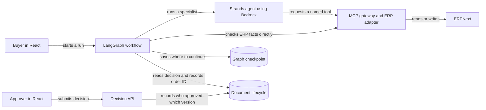

# How to explain ARIA, one purchase at a time

**For your first practice session,** give yourself 15 minutes for steps 1–3. Take a blank sheet, fold it in half, and put the buyer’s story on the left and the graph on the right. Close the guide and explain the purchase from memory before moving on. Steps 4–6 are for a second session when someone starts asking *how*, *what if* and *how do you know?*

## 1. Open with the buyer’s problem

**Say this in about 30 seconds.**

> A maintenance team needs two lift motors at $4,000 each. The buyer has to choose a supplier, check whether the price makes sense, and get approval for the $8,000 purchase. ARIA helps the buyer gather that evidence. When someone approves the request, the system checks that the terms still match and confirms the order in ERPNext. I’ll walk through what the agents investigate and what happens if the purchase changes halfway through.

**Retell the story from four cues.** `buyer → two motors → approval → confirmed order`. For a nontechnical listener, a *requisition* is the internal request to buy, a *purchase order* is the commitment to a supplier, and a *goods receipt* records what actually arrived.

**Make it yours.** Add one sentence about your own contribution. Use “I worked on ___ because the buyer needed ___” and fill it with a change you personally made. A good follow-up is a specific decision you can point to in the code and an example that exercises it. [Project walkthrough](../LANGGRAPH_ARCHITECTURE.md#2-request-and-tool-data-flows)

## 2. Explain who chooses the next action

On the whiteboard draw the following picture in two passes. First draw the buyer’s route to ERPNext across the top. Then add the approver and the two stores underneath. Read each arrow as a verb.



**Say this when someone asks “Where is the AI?”**

> LangGraph chooses the next stage according to rules we wrote. Inside sourcing, a Strands agent uses a Bedrock model to decide which supplier records to inspect. The model might ask for delivery history after seeing that two suppliers have similar prices. Strands runs the tool and gives the result back to the model. The workflow then takes the supplier recommendation into requisition review.

That repeated choice of **tool → observation → next action** is the *agent loop*. Reading actual supplier records is *grounding*. MCP, the Model Context Protocol, gives the specialist named tools with inputs and outputs. The adapter translates those operations into ERPNext requests. The full workflow constructs its specialists inside the workflow runtime. The browser can also invoke a specialist on its own. [Runtime implementation](../../backend/workflow/strands_runtime.py#L114) · [Agent loop in Strands](https://strandsagents.com/latest/documentation/docs/user-guide/concepts/agents/agent-loop/) · [System boundaries](../LANGGRAPH_ARCHITECTURE.md#1-system-architecture)

**Try it.** Point to the box that decides which supplier to recommend. Now point to the function that decides whether that recommendation can proceed automatically. The first is the sourcing specialist. The second is the workflow’s policy code.

## 3. Trace LangGraph in the file you have open

Start at the graph registration near the bottom of `p2p_graph.py`. Read the edges first. Then go to the functions behind them. [Graph registration](../../backend/workflow/p2p_graph.py#L780)

| Stop in the code | What to write in your notes | What it means for the motors |
|---|---|---|
| [`WorkflowState`](../../backend/workflow/p2p_graph.py#L47) | **State** is the set of fields carried through a run. | The document ID identifies the request, the run ID identifies this execution, and the request version identifies the terms being reviewed. |
| [`sourcing`](../../backend/workflow/p2p_graph.py#L302) → [`requisition_analysis`](../../backend/workflow/p2p_graph.py#L329) | A **node** is a Python function that reads state and returns updated fields. An **edge** determines which node runs next. | Sourcing adds its supplier selection, the ERP snapshot and its version. Requisition analysis receives the selected supplier IDs and adds its risk findings and recommendation. |
| [`policy_route`](../../backend/workflow/p2p_graph.py#L438) | A **conditional edge** maps an outcome to a destination. | Even with a favorable recommendation and sufficient budget, $8,000 requires a person. Other requests can be rejected or qualify for verified automatic approval. |
| [`human_review`](../../backend/workflow/p2p_graph.py#L459) | An **interrupt** pauses execution. A **checkpoint** saves state and the pending step under the graph’s thread ID. | The worker can exit while the approver reviews the two motors. A later invocation finds the thread using `document_id:run_id`. |
| [`create_or_recover_po`](../../backend/workflow/p2p_graph.py#L473) → [`await_reconciliation`](../../backend/workflow/p2p_graph.py#L751) if needed | **Resume** continues the existing run. Recovery checks the result of an external action. | After a saved approval, the workflow can create or recover the PO. If it cannot establish what ERPNext did, it pauses for reconciliation. |

**Explain the pause in two sentences.** “The checkpoint tells a new worker where it stopped. The decision API separately records who approved which run and request version, and the worker checks that record before it resumes the purchase.” LangGraph can re-enter an interrupted node from its beginning, so any side effect placed before the interrupt must be safe to repeat. In this project the human-review node starts with the interrupt. [Decision API](../../backend/api/decisions.py#L155) · [Resume check](../../backend/workflow/p2p_graph.py#L907) · [LangGraph interrupts](https://docs.langchain.com/oss/python/langgraph/interrupts)

**Close the file and predict the outcome.** A reviewer sees two motors, approves them, and someone adds a third before PO creation. What remains valid? The decision is still a record of approval for the two-motor version. The $12,000 request needs a fresh review. The fixture ends with `STALE_APPROVAL` and zero POs. [Changed-quantity case](../../backend/evals/requisitions.v1.json#L73)

## 4. Teach each role using the same purchase

Make a card for each role. On the front, write the question it answers. On the back, write **input → action → handoff**. Cover the last column and try saying the handoff out loud.

| Role | Question it answers | Input → action → handoff |
|---|---|---|
| Workflow coordinator | “What is allowed to happen next?” | Request ID and saved state → run the next node or wait → return progress, a pending decision, a confirmed PO ID or a failure reason. The coordinator is graph code. |
| Sourcing specialist | “Who should supply these motors?” | Request ID → compare supplier prices, delivery history, quality and capacity → send selected supplier IDs and a rationale into review. |
| Requisition specialist | “Does the purchase make sense?” | Request ID and selected suppliers → check catalog, duplicates, historical pricing, risk and budget signals → return findings and an approval recommendation to policy. |
| PO management specialist | “How do we place the approved order?” | Approved supplier and item assignment → propose a create-order tool call → the workflow checks and rebuilds the arguments from reviewed terms, then confirms the order in ERPNext. |
| Receiving specialist | “We ordered two. How many arrived?” | PO and linked goods receipts → sum received quantities by item → report one received and one still open if only the first motor arrived. |
| Invoice matching specialist | “The supplier billed for two. What supports the bill?” | Invoice, PO and receipts → compare billed prices and quantities with ordered and received items → flag the unreceived motor for accounts payable. This comparison is a *three-way match*. |
| Payment specialist | “The bill now matches. When should we pay?” | Invoice, terms and payment history → evaluate timing, discounts and reasons to hold → return a recommendation. In the scheduling UI a user separately confirms the ERP payment posting. |
| Chat agent | “Can you help me request the motors?” | User message and conversation context → look up the item and help create a Material Request → return the result to the requester, who can start the workflow from Requisitions. |

**Draw a bracket** around sourcing, requisition review and PO management. These are the three model-driven specialists used by the full LangGraph purchase workflow. The post-PO specialists have separate entry points. For example, the invoices screen can start payment analysis after a successful match. Chat runs in the application Lambda. [Specialist responsibilities and prompts](../LANGGRAPH_ARCHITECTURE.md#4-workflow-runtime-and-specialist-agents) · [Downstream agents and UI handoffs](../LANGGRAPH_ARCHITECTURE.md#5-receiving-invoices-payment-and-chat)

**Explain a change in the evidence.** A second motor arrives tomorrow. Which business fact changes? The goods receipts now support a received quantity of two. Accounts payable can rerun the three-way match. The original purchase approval still describes the same two motors.

## 5. Work through the failure that makes this a system design problem

Suppose ERPNext submits the approved order just as the connection drops. The buyer’s screen times out. Before drawing anything, ask yourself **What evidence would let a replacement worker place another order safely?**

1. Draw the **lifecycle record**. Before the create call leaves the worker, it records a write attempt for this supplier allocation. The stable operation key includes the request ID, run ID, reviewed version and supplier.
2. Draw **ERPNext** and break the return arrow after submission. The worker knows it attempted the purchase. Only an ERP lookup can establish whether the order exists and what it contains.
3. Draw the **replacement worker** reading the same key. A matching submitted order supplies the original ID. A draft from the recorded attempt requires validation before submission. A missing key after a recorded attempt, or an inconclusive lookup, sends the run to `PO_REVIEW`.
4. Add a second supplier. A split award can legitimately produce two POs. The unit of protection is one approved supplier allocation. A worker lease coordinates concurrent workers, and reconciliation resolves the separate question of what happened in the ERP.

**Idempotency** means a repeated logical operation can lead back to the same business result. A checkpoint can replay work, but it cannot tell you whether another system committed during a lost response. In ARIA, the stable key, saved attempt and ERP lookup work together. [Guarded write](../../backend/workflow/p2p_graph.py#L623) · [Recovery branches](../../backend/workflow/p2p_graph.py#L579) · [Completed whiteboard diagram](../LANGGRAPH_ARCHITECTURE.md#the-commit-window)

## 6. Defend the design and its evidence

| Interview question | Build your answer around this reasoning |
|---|---|
| **Why use a graph when a Python function could call three agents?** | A sequential function could run a happy path. Here the buyer may leave for a day, the reviewer may reject, and a worker may disappear after an ERP write. LangGraph provides explicit transitions, checkpoints and interrupts. The team still owns authorization, version checks and ERP reconciliation. |
| **Why use a model when rules are easier to test?** | Supplier assessment combines uneven evidence about price, quality and delivery. A model can gather and explain that evidence. The USD threshold, version comparison and quantity checks have precise rules that code can enforce. At $5,000 a low- or medium-risk `APPROVE` candidate still needs verified ERP facts and budget. At $5,001 it goes to human review even with good evidence. |
| **Why not let a supervisor agent pick the next specialist?** | The business already specifies the order of approval and purchase. A fixed graph makes those transitions inspectable. A dynamic supervisor would be more useful for an open-ended supplier investigation where the required subtasks emerge during research. [Architecture pattern comparison](../LANGGRAPH_ARCHITECTURE.md#7-agent-architecture-patterns) |
| **What should each model remember?** | Give each specialist the context its task needs. Requisition review receives the request ID and selected supplier IDs and can fetch current ERP data. Chat uses recent messages for continuity. The worker uses a checkpoint to find its pending step and a lifecycle record to establish who approved the purchase. [Specialist prompt construction](../../backend/workflow/p2p_graph.py#L329) · [Chat history](../../frontend/src/pages/AgentChat.tsx#L121) |
| **What if the model requests the wrong tool or quantity?** | Treat a tool call as a proposal. On the workflow path, a hook can block PO creation outside the approved step. On the approved path, code checks the supplier and quantities and reconstructs the write from reviewed terms. That enforcement belongs in code at the point where a proposal can become an ERP order. [Tool guard](../../backend/workflow/strands_runtime.py#L41) · [PO argument checks](../../backend/workflow/p2p_graph.py#L623) |
| **How would you evaluate a model change?** | First replay labeled cases to check policy outcomes, supplier allocations and PO count. Then evaluate the live candidate on held-out requests with buyer-reviewed supplier rankings and factual justifications. Track unsupported claims, inappropriate approvals, latency and token cost. Fixed-output replay measures workflow behavior. Live evaluation measures model behavior. |
| **What happens if more buyers use it?** | Different runs have distinct checkpoint threads. A lease protects work on the same requisition. Two different requests can still see the same remaining budget before either spends it. If finance needs a hard spending cap, an atomic reservation would be an additional design requirement. |

**Run one exercise.** From the repository root, use `PYTHONPATH=backend .venv/bin/python -m evals`. First predict the outcomes for `threshold-inclusive`, `changed-after-approval` and `lost-response-after-commit`. Then open their fixture definitions and compare the expected decision, PO count and final status. The suite uses fixed agent responses and a simulated ERP, so it can reproduce the decision boundary and the lost response on demand. [Labeled cases](../../backend/evals/requisitions.v1.json) · [Evaluation runner](../../backend/evals/__main__.py#L114) · [Budget read](../../backend/workflow/p2p_graph.py#L351)

<details>
<summary>Check your three predictions</summary>

- The eligible $5,000 pump request completes with `AI_APPROVED` and one PO.
- The two-motor approval stays on record as `HUMAN_APPROVED`. The three-motor request fails with `STALE_APPROVAL` and zero POs.
- The $6,200 gasket request completes with `HUMAN_APPROVED` and one confirmed PO even after the ERP drops the response.

</details>

## A three-minute rehearsal and a reusable note card

| Clock | What to do from memory |
|---|---|
| 0:00–0:30 | Introduce the buyer, the two motors and what a successful purchase looks like. |
| 0:30–1:15 | Draw the graph and its specialists. Trace one supplier ID from sourcing into the requisition review. |
| 1:15–2:00 | At the $8,000 pause, identify who approves, what is saved and what adding a third motor changes. |
| 2:00–2:40 | Break the response arrow after ERP submission. Explain which record recovery reads first and when it must pause. |
| 2:40–3:00 | Name one fixture that tests your claim and one question that needs live evaluation. |

Copy these prompts onto one card and fill them with **your own words**.

```text
The buyer needs ____________________________________________
A successful purchase ends when ____________________________
The model investigates __________ using evidence from ______
LangGraph carries __________ and routes on _________________
The approver authorizes ____________________________________
If the response is lost, the next worker __________________
One case I can demonstrate is ______________________________
One thing I would measure before rollout is ________________
```

For the first recording, listen for three things. Can a listener say why the $8,000 request paused? Can they point to the supplier handoff? Can they explain why a timeout might still leave a real PO in ERPNext? Rehearse the first point they missed, then try the recording again.
