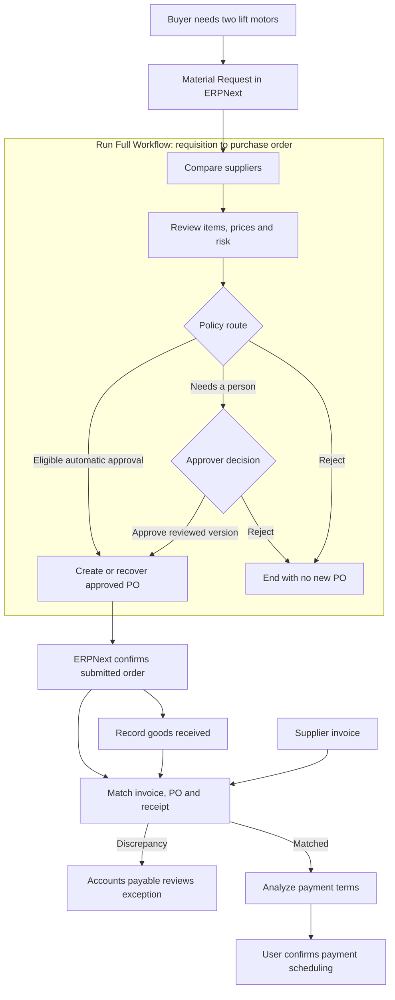
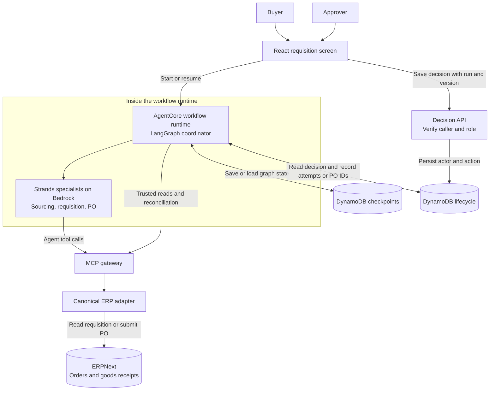
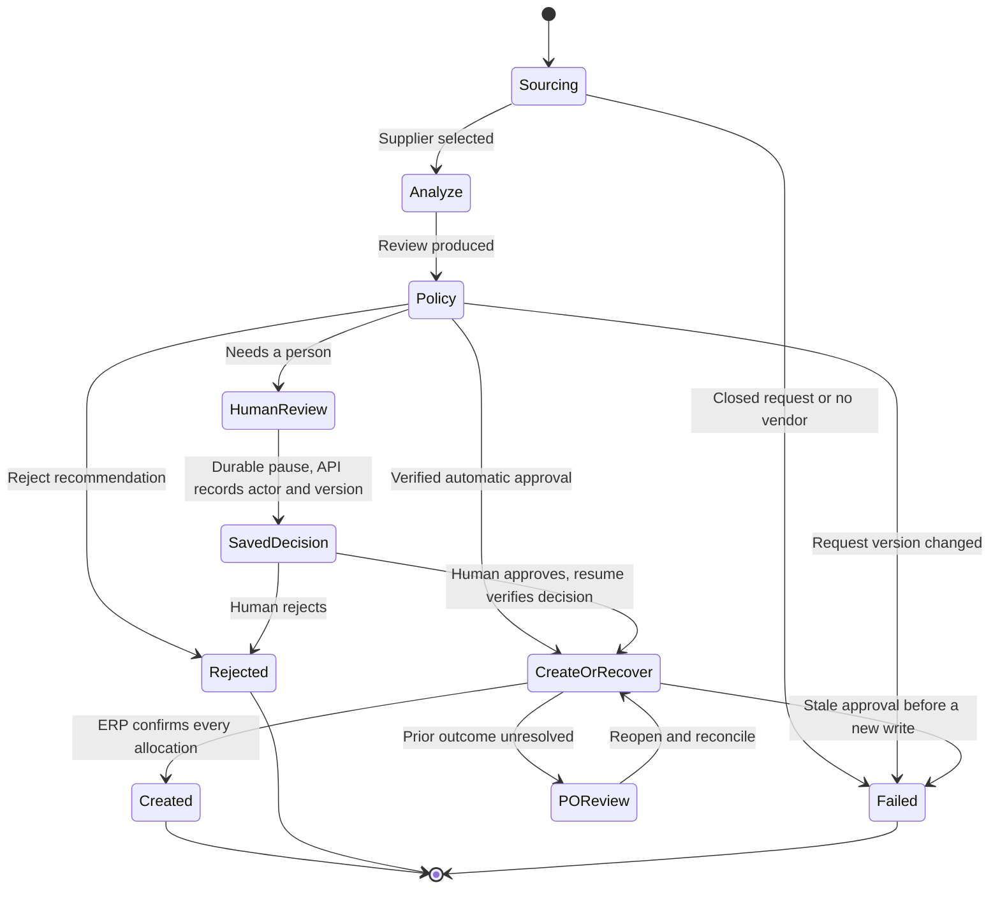
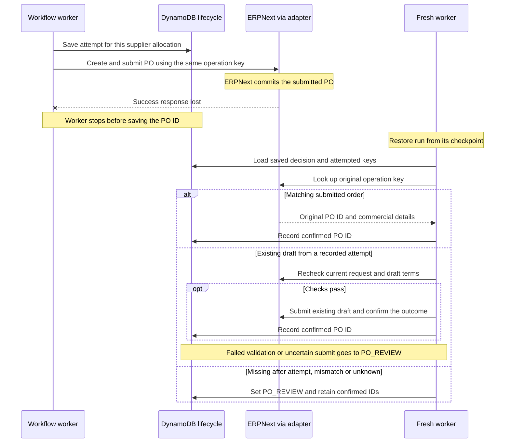
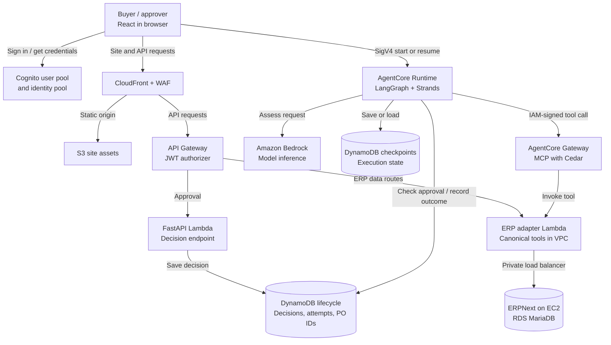
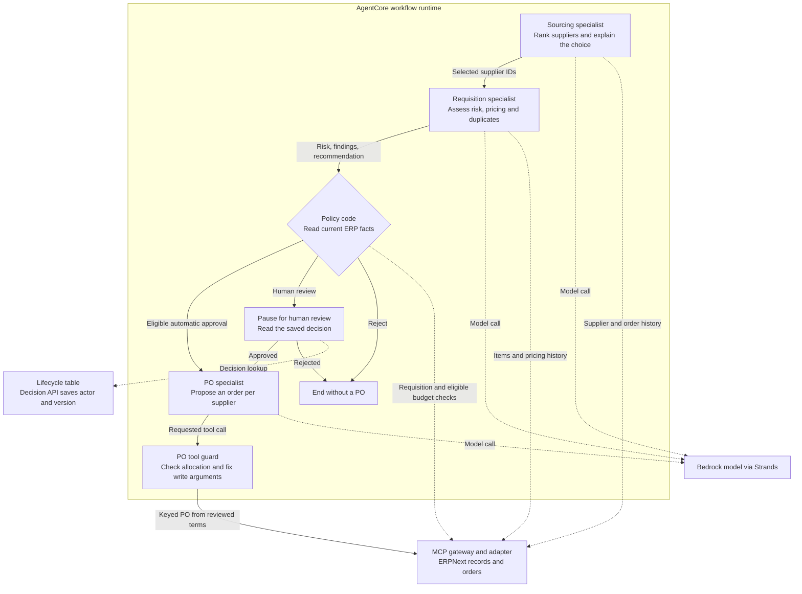
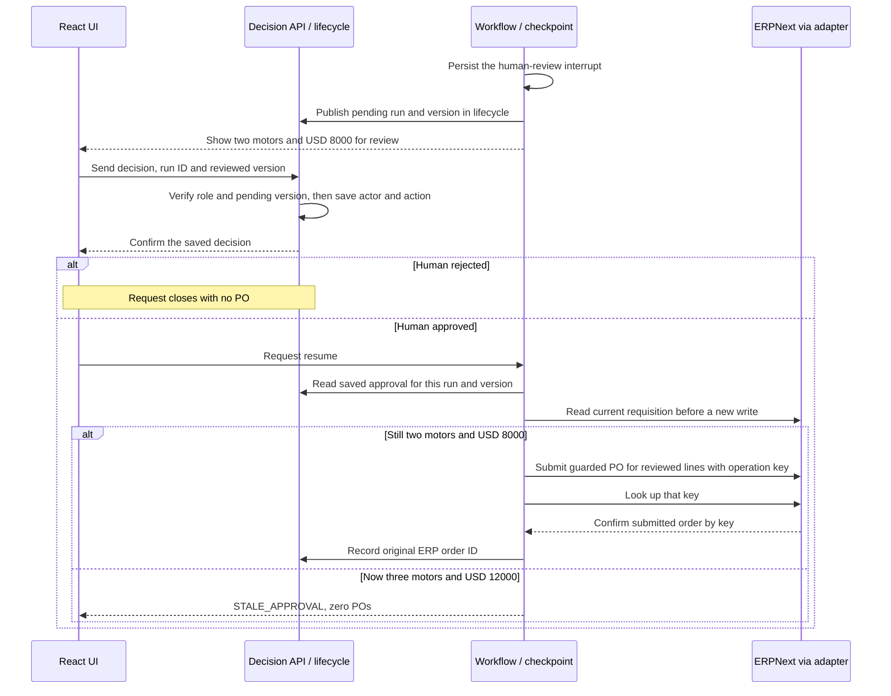
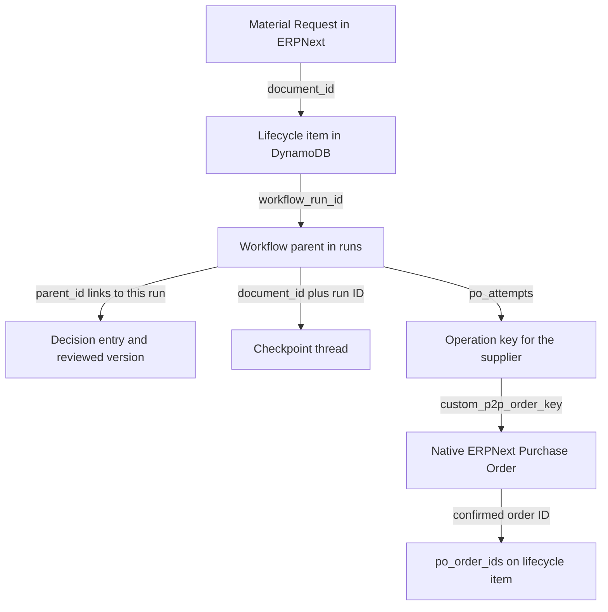
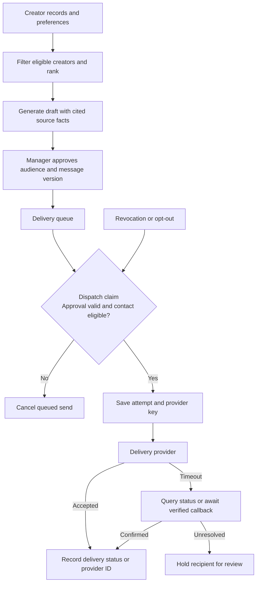

# ARIA procure-to-pay architecture and whiteboard rehearsal

A buyer requests **two lift motors at $4,000 each**. What evidence should the buyer see? Who can authorize the $8,000 purchase? If the ERP submits an order and the worker crashes, what can the buyer safely do next? Follow that one purchase through the product, then rehearse the architecture from memory.

| If the interviewer asks… | Open this part |
|---|---|
| “How do I learn to explain this project from scratch?” | [Step-by-step study notes and practice card](PROJECT_STUDY_NOTES.md) |
| “What does the whole product do?” | [The overall process](#the-overall-process) |
| “Draw the system, the states, and the failure window.” | [Boundaries](#picture-1-system-boundaries) · [State](#picture-2-workflow-state) · [Failure](#picture-3-the-lost-erp-response) |
| “Where does it run? What does the model actually receive?” | [AWS architecture](#where-the-workflow-runs-on-aws) · [Specialist data flow](#inside-the-workflow-runtime) |
| “Prove this user approved these terms.” | [Decision and resume](#human-approval-and-resume) · [Example records](#follow-one-purchase-through-its-records) |
| “How did you test it? Why this design?” | [Evidence and operations](#evidence-and-operations) · [Decisions to defend](#decisions-to-defend) |
| “Can we practice the interview?” | [Timed rehearsal](#timed-panel-rehearsal) · [Unfamiliar design exercise](#blind-design-exercise-creator-outreach) |

### Reading the existing architecture guide

The platform guide moves from a system map to the messages exchanged on one request, then shows the stored record. That order works well on a whiteboard. Its invoice diagrams also show why a goods receipt matters to accounts payable. Three details change the interview story in the current working tree on `feature/langgraph-orchestration`. [Platform architecture](../ARCHITECTURE.md)

| Topic | What to draw for this implementation |
|---|---|
| **Order of work** | The platform workflow picture puts requisition analysis first. The graph starts with **sourcing**, passes selected supplier IDs to requisition analysis, then applies policy. A closed request or missing supplier can stop it early. [Current graph edges](../../backend/workflow/p2p_graph.py#L782) |
| **Automatic approval** | The older picture says low risk up to $5,000. Current code considers an `APPROVE` recommendation at **low or medium risk**, up to and including **USD 5,000**, then checks current ERP amounts, line evidence, currency, cost center, and remaining budget. [Threshold](../../backend/agentcore_app.py#L206) · [ERP checks](../../backend/workflow/p2p_graph.py#L373) |
| **Browser calls and persistence** | Draw a signed browser call to the workflow runtime and a separate authenticated decision API call. Add two DynamoDB tables. Execution checkpoints tell a worker where to resume. Lifecycle records tell procurement who decided and which ERP IDs were confirmed. [Browser client](../../frontend/src/agentcore.ts#L146) · [Decision UI](../../frontend/src/pages/Requisitions.tsx#L539) · [Tables](../../infra/lib/p2p-agentic-stack.ts#L172) |

## The overall process

Start here with a business audience. A **material request** says what someone needs. A submitted **purchase order (PO)** commits the purchase in ERPNext. A **goods receipt** records what actually arrived. A buyer can have a valid PO for two motors while the warehouse has received only one.



**Walk the buyer through it.** “Sourcing recommends `SUP-LIFT`. Requisition analysis returns medium risk and recommends approval. At $8,000 the request needs a person. If the approved terms still match, the workflow can submit a PO for two motors. When the supplier invoices for both but only one is on the receipt, accounts payable has a discrepancy to investigate. Receiving, matching and payment are separate downstream activities.” [Fixture](../../backend/evals/requisitions.v1.json#L73) · [Receiving and matching inventory](../ARCHITECTURE.md#5-agent-inventory)

| Moment in the $8,000 request | What the user or worker can establish |
|---|---|
| Supplier recommendation | The fixture names `SUP-LIFT`. A buyer evaluating a real recommendation would ask to see comparable prices, delivery history, and gaps in the evidence. |
| Policy evaluation | The ERP says two × $4,000. The model’s recommendation is recorded. The amount sends the purchase to human review. |
| Approved and unchanged | This is the walkthrough branch. Verify the saved approval and the live request, write once per authorized allocation, and return the confirmed ERP ID. |
| Approved and changed | This is the **actual $8,000 fixture**. A third motor makes the total $12,000. The old approval covers two. The run returns `STALE_APPROVAL` and creates **zero POs**. |
| ERP submitted but the response was lost | The separate **$6,200 gasket fixture** exercises recovery. Repeated resume finds the original submitted PO. [Both labeled outcomes](../../backend/evals/requisitions.v1.json#L73) |

## Draw the three pictures

Use a blank board and a timer. For each picture, read the interview question, cover the diagram, and draw your answer. Reveal the diagram to check the **arrows and their labels**. A box named “DynamoDB” earns little credit until you say what question that particular record can answer.

### Picture 1 System boundaries

**Interview question.** “I click Run Full Workflow. Which components can recommend, approve, and actually place the order?”



1. **Draw the people and two arrows out of React.** Label the arrows *run* and *decide*. Ask who the decision API trusts.
2. **Draw the compute and tool path.** Nest the three specialists inside the workflow runtime. The MCP gateway and adapter connect them to ERPNext. Also draw the workflow’s own ERP reads.
3. **Add the three sources of truth.** LangGraph checkpoint → next executable step. Lifecycle → approved version, actor, attempts and confirmed PO IDs. ERPNext → the submitted order and the later goods receipt.

**Say while drawing.** “The checkpoint lets a new worker pick up the run. The approval record explains who authorized this purchase. If either one says an order should exist, I still have to ask ERPNext whether it does.”

**Pause at the fork.** “Would you like to follow the identity on the decision call or the data on the tool call?” [Runtime composition](../../backend/agentcore_app.py#L446) · [Decision verification](../../backend/api/decisions.py#L199)

### Picture 2 Workflow state

**Interview question.** “Walk me from a new request to its terminal state. Where could a new worker take over?”



1. Start with **sourcing → analysis → policy**. Draw three routes leaving policy. An agent’s risk assessment is one input into routing.
2. Draw the **durable pause** before making review actionable. Draw the stored decision as an API event on the board. In code, `human_review` uses `interrupt()` and the outer invocation consults the lifecycle record before supplying `Command(resume=True)`. Rejection closes the business run. [Gate publication and resumption](../../backend/workflow/p2p_graph.py#L844)
3. Draw the **return loop** from `PO_REVIEW` to reconciliation. On the simpler changed-request branch, with no prior write to account for, a stale version stops the run with zero orders. If a draft or partial split already exists, the operator must account for it. [Current-version and receipt checks](../../backend/workflow/p2p_graph.py#L543)

**Say while drawing.** “Someone just changed the quantity to three. I keep the fact that the approver authorized two. I have no authority for the extra $4,000. The changed request needs a new review.”

**Pause at human review.** Let the interviewer choose rejection, a direct call to resume, or a third motor. For a bare resume, point to the saved-decision check. [Graph definition](../../backend/workflow/p2p_graph.py#L781) · [Approval tests](../../backend/tests/test_workflow_decisions.py#L50)

### Picture 3 The lost ERP response

**Interview question.** “ERPNext committed the order. The worker crashed before recording success. Do you retry?”



1. Draw three lanes. Put **attempt saved** on the workflow side, then **order committed** on the ERP side. Cross out the reply. Ask the interviewer what each system knows at that instant.
2. Add the replacement worker. It restores the run and looks up the original key, derived from **requisition ID + workflow run ID + reviewed request version + supplier ID**. The ERP field must be unique. The lease coordinates workers. The key lets a later worker find an external side effect after ownership changes. [Key construction](../../backend/workflow/p2p_graph.py#L503) · [ERP schema](../../utilities/scripts/workflow_po_schema.py#L6)
3. Draw the three recovery outcomes. Reserve a separate corner for a supplier allocation that **has never been attempted**. It may receive its first write once all approval and live ERP checks pass. [Reconciliation branches](../../backend/workflow/p2p_graph.py#L579) · [Keyed adapter](../../backend/adapters/erpnext/adapter.py#L450)

| ERP lookup | What a retry may do | What to show procurement |
|---|---|---|
| Submitted order matches supplier, currency and reviewed line items, quantities and prices | Reuse its ID and record the confirmation. | The original order number. |
| Matching draft for an attempted allocation | Revalidate saved approval, live request and draft commercial details. Submit that same draft only if checks pass and confirm its state. | A confirmed ID on success. Route unresolved or changed terms to review. |
| Missing key after a recorded attempt, ambiguous response, or mismatched order | Hold in `PO_REVIEW` and reconcile again when evidence is available. | The affected requisition, confirmed IDs, and which allocation needs investigation. |
| Missing key and no prior attempt for that allocation | Check the current request, reserve the attempt, then issue its first guarded write. | Its resulting status alongside any confirmed split-award orders. |

**Say while drawing.** “A timeout tells me what the worker heard. It doesn’t tell me what the ERP did. I can safely retry the lookup. My next write depends on what that lookup establishes.”

**Pause with two supplier rows.** Supplier A is confirmed. Supplier B has an unresolved attempt. Ask which row can be marked complete and whether the buyer should place another order. [Partial split test](../../backend/tests/test_workflow.py#L523)

<details>
<summary>Blank-board drill and scoring key</summary>

Set three timers: **90 seconds for boundaries, two minutes for state, three minutes for failure**. Start each drawing on an empty board. Give yourself one point per row when you can draw and explain every item.

| Drawing | Check your reconstruction |
|---|---|
| Boundaries | Two browser arrows, a guarded tool path into ERPNext, and distinct answers from checkpoint, lifecycle, and ERP. |
| State | Sourcing first, all three policy routes, a versioned human decision, and a loop for uncertain POs. |
| Failure | Attempt saved before the call, ERP commit before the crash, same-key lookup, and the submitted/draft/unknown outcomes. |

Now change one fact. Move the crash to *after the attempt was saved but before the request left the worker*. On restart a missing key still leaves an attempted allocation unaccounted for. The conservative decision costs an operator review and avoids gambling on whether a write reached ERPNext.

</details>

## Where the workflow runs on AWS

“I’d draw two arrows out of the buyer’s browser. **Run Full Workflow** and **Resume** invoke AgentCore directly with signed AWS requests. **Approve** sends a separate authenticated request to the decision API. If I reload the page between those actions, the saved approval still belongs to the same requisition version and run.” [Browser runtime client](../../frontend/src/agentcore.ts#L79) · [Decision and resume in React](../../frontend/src/pages/Requisitions.tsx#L539) · [Decision API](../../backend/api/decisions.py#L155)



**Where does the approver’s identity end and the service identity begin?** “API Gateway verifies the Cognito token. The decision API checks the server-issued role and saves the approver, workflow run, and request version. The tool gateway sees the runtime’s IAM principal. The workflow constrains the PO tool and requires the saved approver’s ERP identity for a human-approved write in the configured AWS path. Today the Cedar policy permits the listed ERP tools broadly for IAM principals. Narrowing those grants by specialist would be a concrete production-hardening step.” [Role check](../../backend/api/decisions.py#L199) · [Tool hook](../../backend/workflow/strands_runtime.py#L50) · [Cedar permits](../../infra/policies/p2p-procurement.cedar#L11) · [Adapter caller selection](../../backend/adapters/canonical_api.py#L717)

| Boundary | AWS configuration in this checkout | Local rehearsal |
| --- | --- | --- |
| Browser and identity | CloudFront serves the private S3 site and forwards API requests. Cognito supplies a JWT for the API and temporary credentials for signed runtime calls. | Vite serves React. Guest mode and the local proxy replace browser sign-in and signing. A loopback-only test approver can be explicitly enabled. |
| Workflow and models | AgentCore hosts the workflow. Strands uses Bedrock for assessments inside LangGraph nodes. | The full harness uses local runtime and gateway shims with real Bedrock inference. Fixture replay supplies deterministic model outputs. |
| ERP boundary | The MCP gateway invokes a VPC adapter Lambda. The adapter reaches the separately defined ERPNext stack over its internal load balancer. ERPNext on EC2 uses RDS MariaDB. | The full harness uses a Docker ERPNext site. The labeled evaluation and restart test use simulated ERP records. |
| State and operations | Two DynamoDB tables hold execution and business state. The CDK defines CloudWatch metrics and alarms and an SNS topic for operators. | DynamoDB Local persists both tables in Docker. JSON logs carry the workflow run ID. Offline replay uses Moto. |

The diagram depicts the CDK configuration. The operational test before a pilot is to use a staging approver, a real ERP write and a deliberately lost response, then verify that the operator receives the alert and can reconcile the original order. [CloudFront and API routes](../../infra/lib/p2p-agentic-stack.ts#L893) · [ERP deployment](../../infra/lib/erpnext-stack.ts#L435) · [Checkpoint grants](../../infra/lib/p2p-agentic-stack.ts#L475) · [Monitoring and alarms](../../infra/lib/p2p-agentic-stack.ts#L532) · [Local equivalents](../../local/README.md#L13)

### What happens after the purchase order?

“The motor order can exist before either motor arrives. The requisition graph finishes once its approved supplier allocations have confirmed POs. I’d extend the board with the records the warehouse and accounts payable need next.” [Current graph edges](../../backend/workflow/p2p_graph.py#L781) · [Broader platform overview](../ARCHITECTURE.md#5-agent-inventory)

| Business event | What happens in the implementation |
| --- | --- |
| Goods arrive | Receiving reads the PO and sums receipts by item. One motor received against two ordered leaves one open. The receiving view can invoke this analysis independently. [Receiving agent](../../backend/agents/receiving_agent.py#L39) · [Receiving screen](../../frontend/src/pages/GoodsReceipts.tsx#L83) |
| An invoice arrives | An electronic purchase invoice can already exist in ERPNext. A PDF upload initiates extraction and an adapter call to create the invoice record. [Invoice processing](../../backend/api/invoices.py#L160) |
| Accounts payable checks the bill | Invoice matching compares the invoiced lines with PO prices and received quantities. If the vendor bills for two motors while only one has arrived, the reviewer can inspect the discrepancy. The invoices screen can invoke payment analysis on a match. [Three-way match](../../backend/agents/invoice_matching_agent.py#L53) · [UI handoff](../../frontend/src/pages/Invoices.tsx#L228) |
| A payment is scheduled | The payment agent checks terms, discounts and existing payments. The scheduling screen has a separate confirmation that calls the payment API, which asks the adapter to create the ERP payment entry. Bank settlement is outside the evidence shown here. [Payment analysis](../../backend/agents/payment_agent.py#L37) · [User confirmation](../../frontend/src/pages/Invoices.tsx#L277) · [Scheduling endpoint](../../backend/api/invoices.py#L289) |

## Inside the workflow runtime

**Draw first.** Put sourcing and requisition analysis inside one LangGraph workflow. Label the arrow between them “selected supplier IDs.” Add the PO specialist only after drawing the approval gate.



**Say it aloud.** “The sourcing agent picks a supplier and explains its evidence. The requisition agent receives those supplier IDs and reviews the purchase. In our example it recommends approval for two $4,000 motors. The code reads $8,000 from ERPNext and routes it to a person. Even on the approved branch, the PO specialist only proposes a tool call. Code checks the allocation, builds the arguments from the reviewed lines, and records the attempt before the request leaves the worker.” [Specialist handoff](../../backend/workflow/p2p_graph.py#L329) · [Policy against ERP facts](../../backend/workflow/p2p_graph.py#L373) · [PO write preparation](../../backend/workflow/p2p_graph.py#L623)

**Interruption — “Does every specialist have its own IAM role?”** “In this workflow, they run inside one AgentCore runtime. The Cedar policy grants its IAM principal broad access to the listed ERP tools. The workflow’s Strands hook blocks PO creation during assessment and leaves reconciliation to workflow code. For a rollout that requires independently enforced read and write privileges, I’d split those identities and test each permission in staging.” [Runtime construction](../../backend/agentcore_app.py#L446) · [Tool guard](../../backend/workflow/strands_runtime.py#L50) · [Cedar grants](../../infra/policies/p2p-procurement.cedar#L11)

### Who reads, writes and authorizes

| Component | What it reads | What it writes or authorizes |
|---|---|---|
| Sourcing and requisition specialists | Supplier records, historical POs, request lines and pricing through MCP | Return vendor choice, findings and recommendation. The workflow saves the analysis. [Agent calls and persistence](../../backend/workflow/p2p_graph.py#L302) |
| Policy code | Current request version, ERP amount and currency, agent findings, and cost-center budget for automatic candidates | Saves rejection or policy approval, or routes the request to human review. The inclusive USD 5,000 ceiling also requires low or medium risk, an approval recommendation and passing ERP checks. [Threshold](../../backend/agentcore_app.py#L219) · [Routing](../../backend/workflow/p2p_graph.py#L438) |
| Decision API and lifecycle table | Verified role claim and the pending run and version | An authorized approver, procurement user or admin can approve or reject. The API saves the actor, action and reviewed version against that run. [Role check](../../backend/api/decisions.py#L199) · [Decision write](../../backend/services/lifecycle.py#L764) |
| LangGraph and checkpoint table | Saved execution state and next node, keyed by requisition and run | Persist the pause and allow a fresh worker to continue. On resume the workflow checks the decision in the lifecycle record. [Checkpoint lookup](../../backend/workflow/p2p_graph.py#L868) · [Resume gate](../../backend/workflow/p2p_graph.py#L907) |
| PO guard and ERP adapter | Approved supplier allocation and reviewed lines, current ERP requisition, supplier and commercial terms | The guard authorizes this tool call and records the attempt. The adapter validates the request and ERPNext submits the order. The workflow records the confirmed ERP ID in the lifecycle table. [Guard](../../backend/workflow/p2p_graph.py#L623) · [ERP validation](../../backend/adapters/erpnext/adapter.py#L380) · [Save confirmed IDs](../../backend/workflow/p2p_graph.py#L734) |

## Human approval and resume

**Draw first.** Split the two requests leaving the browser. One saves a decision. The other asks a checkpointed workflow to continue. The decision API and lifecycle store share a lane here. The workflow reads and writes the store directly, while the browser uses the API.



**Say it aloud.** “I can restart the worker because the review has already been checkpointed. I can also close the browser after the decision is saved. A later invocation can recover the same run. For a human-approved order, it uses the approver identity from the saved decision. If the buyer has added a third motor, that person has only approved two. The current version differs and I stop before creating an order.” The unchanged path is the design walkthrough. The labeled two-to-three-motor case exercises the stale branch. [Browser decision and resume](../../frontend/src/pages/Requisitions.tsx#L539) · [Saved approval and identity](../../backend/workflow/p2p_graph.py#L473) · [Current-version check](../../backend/workflow/p2p_graph.py#L543) · [Two-motor fixture](../../backend/evals/requisitions.v1.json#L73)

**Interruption — “Can I approve by calling resume directly?”** “A resume supplies an execution instruction. The worker still needs the stored approval for this run and reviewed version. Without it the response is `APPROVAL_REQUIRED`. If somebody posts an old version to the decision API, the decision itself is rejected as stale.” [Resume handling](../../backend/workflow/p2p_graph.py#L907) · [Stale and repeated decisions](../../backend/services/lifecycle.py#L764)

### The decision the browser actually sends

For the unchanged walkthrough, the relevant fields of the browser request could look like this. The authenticated actor comes from verified claims. A repeated identical decision on this run and version is handled idempotently. A stale run or version can return HTTP 409. [Request fields](../../frontend/src/pages/Requisitions.tsx#L539) · [API conflict mapping](../../backend/api/decisions.py#L156)

```json
{
  "document_type": "PR",
  "document_id": "MAT-MR-2026-00042",
  "action": "APPROVE",
  "workflow_run_id": "ad762f2d-71de-4325-a1b9-0a803ea5f28b",
  "request_version": "496a199ce48c2e9cb9a91c53494487b766ecb90e214a73fdfa268afacaa84884",
  "justification": "Two lift motors at USD 4000 each"
}
```

## Follow one purchase through its records

A buyer opens one requisition and sees one workflow. A replacement worker has three questions to answer. **Where do I resume?** Read the LangGraph checkpoint. **Who approved what, and has anyone attempted the write?** Read the lifecycle item. **Did the purchase order actually commit?** Ask ERPNext for the order associated with the operation key.

These are **illustrative projections** of the unchanged two-motor, $8,000 walkthrough. The IDs and approver are fictional. The examples use matching identifiers across stages. The actual $8,000 fixture adds a third motor after approval and ends with zero POs. The separate $6,200 lost-response fixture checks the successful recovery path. [Labeled cases](../../backend/evals/requisitions.v1.json#L73)

The lines below show how to trace one purchase across stores. Each arrow names the join a reviewer or operator can make.



### 1. Checkpoint at the human-review pause

The graph opens a DynamoDB saver with consistent reads and compression enabled. Its thread ID is the requisition ID joined to the workflow run ID with a colon. Here is a reduced, JSON-readable view of what the worker gets from `graph.aget_state(config)` at the pause. The `next` field identifies the node waiting to continue. [Graph state and saver](../../backend/workflow/p2p_graph.py#L47) · [Thread construction and resume](../../backend/workflow/p2p_graph.py#L869)

```json
{
  "config": {
    "configurable": {
      "thread_id": "MAT-MR-2026-00042:ad762f2d-71de-4325-a1b9-0a803ea5f28b",
      "checkpoint_ns": "",
      "checkpoint_id": "1f08e1ff-d3ae-62b6-8003-6c506e59819f"
    }
  },
  "next": ["human_review"],
  "values": {
    "document_id": "MAT-MR-2026-00042",
    "run_id": "ad762f2d-71de-4325-a1b9-0a803ea5f28b",
    "request_version": "496a199ce48c2e9cb9a91c53494487b766ecb90e214a73fdfa268afacaa84884",
    "outcome": "PENDING_APPROVAL"
  }
}
```

<details>
<summary>Inspect the physical DynamoDB checkpoint metadata</summary>

The physical table has string keys `PK` and `SK`. In the installed `langgraph-checkpoint-aws` 1.3.0, the corresponding metadata item can look like this after DynamoDB attribute decoding. It points to the serialized payload. The saver also stores task writes and uses them to reconstruct the interrupted state. The application reads these through LangGraph. [Table schema](../../infra/lib/p2p-agentic-stack.ts#L179) · [Saver dependency](../../backend/requirements.txt#L18)

```json
{
  "PK": "CHECKPOINT_MAT-MR-2026-00042:ad762f2d-71de-4325-a1b9-0a803ea5f28b",
  "SK": "#1f08e1ff-d3ae-62b6-8003-6c506e59819f",
  "id": "1f08e1ff-d3ae-62b6-8003-6c506e59819f",
  "ns": "",
  "ref_loc": "DYNAMODB",
  "ref_key": "CHUNK_MAT-MR-2026-00042:ad762f2d-71de-4325-a1b9-0a803ea5f28b##1f08e1ff-d3ae-62b6-8003-6c506e59819f"
}
```

</details>

### 2. Lifecycle after approval and the first write attempt

The decision API resolves the pending decision entry for this run and request version. The workflow later records the supplier’s key in the parent run’s `po_attempts` before sending the write. Here is a reduced **decoded** lifecycle item at that point. In the raw DynamoDB item, the service serializes `runs` and `po_order_ids` as JSON strings. The requisition ID is the partition key. [Lifecycle serialization](../../backend/services/lifecycle.py#L95) · [Approval checks](../../backend/services/lifecycle.py#L764) · [Attempt recording](../../backend/services/lifecycle.py#L838)

```json
{
  "document_id": "MAT-MR-2026-00042",
  "document_type": "PR",
  "workflow_run_id": "ad762f2d-71de-4325-a1b9-0a803ea5f28b",
  "status": "PO_GENERATION",
  "current_step": "po_generation",
  "runs": [
    {
      "id": "ad762f2d-71de-4325-a1b9-0a803ea5f28b",
      "type": "workflow",
      "agent": "workflow",
      "request_version": "496a199ce48c2e9cb9a91c53494487b766ecb90e214a73fdfa268afacaa84884",
      "po_attempts": ["64db6311def118d29a1e5b270f0e45579345a62499e985822d1eb93ee3dd03c2"]
    },
    {
      "parent_id": "ad762f2d-71de-4325-a1b9-0a803ea5f28b",
      "type": "analysis",
      "agent": "requisition",
      "recommendation": "APPROVE"
    },
    {
      "parent_id": "ad762f2d-71de-4325-a1b9-0a803ea5f28b",
      "type": "decision",
      "action": "HUMAN_APPROVED",
      "status": "approved",
      "decided_by": "reviewer@example.com",
      "approver_email": "reviewer@example.com",
      "request_version": "496a199ce48c2e9cb9a91c53494487b766ecb90e214a73fdfa268afacaa84884"
    }
  ]
}
```

The requisition analysis can say `APPROVE` before a human has decided. At resume, the graph checks the saved decision and reviewed version. It derives the operation key by hashing the tuple `["p2p-po", document_id, run_id, request_version, supplier_id]` as a compact JSON array. A split award gets a separate key for each supplier. [Reviewed-version hash](../../backend/utils/purchase_control.py#L10) · [Decision and operation key](../../backend/workflow/p2p_graph.py#L473)

### 3. ERPNext commit and the confirmation returned to the worker

Suppose the worker dies after ERPNext submits the PO. The lifecycle item above is compatible with both a committed and an uncommitted write. A replacement worker queries ERPNext by the same key. In a submitted **native ERPNext Purchase Order**, the relevant fields look like this. [Keyed insert](../../backend/adapters/erpnext/adapter.py#L450) · [Unique field definition](../../utilities/scripts/workflow_po_schema.py#L6)

```json
{
  "name": "PUR-ORD-2026-00018",
  "docstatus": 1,
  "custom_p2p_order_key": "64db6311def118d29a1e5b270f0e45579345a62499e985822d1eb93ee3dd03c2",
  "supplier": "SUP-LIFT",
  "currency": "USD",
  "grand_total": 8000,
  "items": [
    {"item_code": "LIFT-MOTOR", "qty": 2, "rate": 4000, "material_request": "MAT-MR-2026-00042"}
  ]
}
```

The **reconciliation response** is the adapter’s canonical view. Here the worker can check the returned PO ID, supplier, currency, requisition link, items, quantities and unit prices against the approved allocation. ERPNext owns the submitted document and its native status. The workflow stores the confirmed identifiers after the comparison succeeds. [Canonical response](../../backend/adapters/canonical_api.py#L442) · [Field mappings](../../backend/adapters/erpnext/field_maps.py#L75) · [Comparison and recovery](../../backend/workflow/p2p_graph.py#L557)

```json
{
  "status": "submitted",
  "purchase_order": {
    "order_id": "PUR-ORD-2026-00018",
    "supplier_id": "SUP-LIFT",
    "currency": "USD",
    "total_amount": 8000,
    "line_items": [
      {"item_id": "LIFT-MOTOR", "quantity": 2, "unit_price": 4000, "requisition_id": "MAT-MR-2026-00042"}
    ]
  }
}
```

After confirmation, the same decoded **lifecycle item** includes the following fields. In a split award, `po_order_ids` can contain several valid IDs. The PO specialist’s child analysis also carries `result.created_order_ids`. A missing key after a recorded attempt leaves the run in `PO_REVIEW` while an operator checks the ERP. A matching draft from an attempted key requires the current requisition and draft terms to pass validation before submission. [Outcome recording](../../backend/services/lifecycle.py#L858) · [Restart assertions](../../backend/tests/test_dynamodb_local_restart.py#L120)

```json
{
  "document_id": "MAT-MR-2026-00042",
  "status": "PO_CREATED",
  "current_step": "complete",
  "po_order_id": "PUR-ORD-2026-00018",
  "po_order_ids": ["PUR-ORD-2026-00018"],
  "po_total_amount": 8000
}
```

The original architecture diagram shows the lifecycle item and its parent-linked `runs` tree. It also documents standalone “Run Analysis” entries, which can be written without a workflow approval or a PO. For the current full workflow, add the separate checkpoint table and draw sourcing before requisition analysis. A purchase-order confirmation in this example is distinct from the downstream **goods receipt** recorded when equipment arrives. [Original architecture and standalone path](../ARCHITECTURE.md#L372) · [Original record example](../ARCHITECTURE.md#L493) · [Current graph edges](../../backend/workflow/p2p_graph.py#L782)

## Evidence and operations

**A. What has been observed.** The earlier local replay passed **13 of 16** labeled cases. The three misses each allowed an unsafe automatic approval. On this working tree, all **16 of 16** matched their labels, including an understated model total, missing budget evidence, and an ERP budget failure reported by the model as a pass. The replay uses the actual graph, fixed specialist outputs, an in-memory LangGraph saver, Moto for lifecycle storage, and a simulated ERP. It measures the decisions and effects produced from those inputs. To measure a model change, collect fresh predictions on held-out requests and ask buyers to assess the supplier selection and supporting evidence. [Runner](../../backend/evals/__main__.py#L114) · [Verification history](../../local/README.md#L131)

| Question | Executable evidence | What it establishes |
|---|---|---|
| Can an old decision or a duplicate click authorize a new purchase? | Version-change and duplicate-approval tests. | The stale request stops. A repeated decision on the same run preserves its outcome. [Workflow tests](../../backend/tests/test_workflow.py#L340) |
| Can an interrupted submit or a partial split issue another PO? | Targeted tests cover lost responses, draft validation, unknown outcomes, partial splits, and competing resumes. | **Nine test cases passed** in the targeted local run, counting parameterized cases. The assertions include preserving the first supplier’s receipt and holding an uncertain second allocation. [Recovery tests](../../backend/tests/test_workflow.py#L405) · [Partial split](../../backend/tests/test_workflow.py#L523) |
| What survives worker and database replacement? | A separate Docker test replaces DynamoDB Local containers with a retained volume and starts fresh workers against a SQLite-backed ERP double. | Its assertions check one run, the original approval, completed specialists running once, and two resumes returning the same simulated PO ID. This is a separate persistence test from the 16-case replay. [Restart assertions](../../backend/tests/test_dynamodb_local_restart.py#L120) |
| What needs staging evidence? | Run with real identities, Bedrock, the MCP gateway and ERPNext. Inject an ambiguous response, then let the designated operator resolve it. | Validate the effective ERP identity and unique key, match live output quality against reviewed cases, confirm alarm delivery, and measure actual latency and cost. [Monitoring configuration](../../infra/lib/p2p-agentic-stack.ts#L532) |

To replay the labeled cases from the repository root with the backend environment installed:

```bash
PYTHONPATH=backend .venv/bin/python -m evals
```

**B. Engineering KPIs and C. business KPIs.** Use `workflow_run_id` to join the initial run, decision, and later invocation. Lifecycle stores the business outcome. The configured dashboard tracks step duration, approval wait, ERP calls and tokens. End-to-end processing p95 and cost per completion need a per-run or cohort calculation. [Telemetry](../../backend/utils/workflow_telemetry.py) · [Dashboard](../../infra/lib/p2p-agentic-stack.ts#L580)

| KPI | Measurement and comparison | Decision |
|---|---|---|
| Engineering · Duplicate orders | Count excess submitted ERP orders **per approved supplier allocation** and reconcile them to approvals. One valid split award can produce two POs. | Investigate any duplicate. Pause the affected write path. |
| Engineering · Successful resumes | Trials that recover the correct state and PO count divided by restart trials. Test the same failure windows before and after a release. | Block release on a lost approval or duplicate commitment. |
| Engineering · Active p95 and unit cost | Sum active intervals across invocations for each run, exclude human wait, then take p95. Divide cohort model and runtime spend including retries by completed requisitions. Match the case mix. | Simplify the slow or expensive step, then rerun quality and control tests. |
| Business · Cycle time and handling | Compare median and p90 time from submitted requisition to submitted PO. Sample actual minutes buyers **and exception reviewers** spend on matched purchases. Report open cases separately. | Expand where work falls and exception handling stays manageable. |
| Business · Eligible automation | Fix eligibility with finance up front. Measure completed eligible purchases with no human touch divided by all eligible requests. | Expand the category or adjust the pilot if reviewers inherit the saved work. |

**What if two requests share the last $6,000?** Draw two concurrent $4,000 requests with one cost center. Both can independently read a sufficient balance. The current budget check is a point-in-time read. If finance requires a hard spending cap, propose an ERP-side reservation or atomic debit. Test the concurrent case in staging before enabling automatic approval for that cohort. [Budget lookup](../../backend/workflow/p2p_graph.py#L351)

## Decisions to defend

| Requirement | Simplest viable design | Current choice and price paid | What would make me change it |
|---|---|---|---|
| Explain a supplier choice | Rank approved vendors with SQL filters and an agreed score. | A specialist synthesizes evidence and explains conflicting signals. Model calls add latency and variability. | If buyers give a rules-based ranking equivalent scores in a category, use the rules there. |
| Coordinate sourcing, review, and ordering | One agent with scoped tools. | Three specialists in one workflow make handoffs and failures inspectable. One weak supplier choice can propagate to the reviewer. | Compare a single agent on the same cases behind identical controls. Try removing the PO model call first because code already builds the commercial payload. |
| Survive human review and worker loss | Persist an explicit Python state machine. | LangGraph supplies conditional edges, durable interrupts and resume. Checkpoint schemas and migrations become operational dependencies. | Use the smaller state machine if the workflow stabilizes and the team can test the same recovery contract. |
| Limit who can spend | Gate the write in an application service. | The decision API verifies the human. The graph hook, adapter, and ERP constrain the write. The runtime IAM tool grant is broader than an individual specialist’s duties. | Add independent read/write identities if rollout requires narrower infrastructure permissions. |
| Recover an external side effect | Ask whether the ERP offers idempotent submit and reliable status lookup. | This adapter uses a unique key, durable attempt, and checked recovery. Some outcomes need an operator. | Adopt the ERP’s native guarantee if it covers submission and status under timeout. Revisit the manual-review rate after measuring. |
| Measure model quality | Review a few demos. | Labeled replays make policy regressions reproducible. Fixed outputs do not exercise a live model. | Add blinded buyer ratings, tool-choice checks, groundedness and case coverage before switching prompts or models. |

**“Why would ordinary software be sufficient for parts of this?”** “I know the reviewed quantity, price, role, and dollar ceiling. I can express those checks directly and test their boundaries. I use the model where a buyer needs someone to compare evidence and explain a judgment. For a contracted part with one supplier and a fixed price, I’d start with a lookup.”

## Timed panel rehearsal

### The 90 second opening

> I’m a forward deployed engineer. At MRO Electronics, I worked with procurement stakeholders on the steps between someone requesting a part and a buyer placing the order. I integrated LangGraph into an existing procure-to-pay platform. I kept the sourcing and requisition specialists and changed how the application coordinated their work. The buyer needed help deciding which supplier to use. The approver needed to know exactly what they were signing off on.
>
> Imagine we need two lift motors at four thousand dollars each. Sourcing finds a supplier, the system reviews the request, and eight thousand dollars goes to a person for approval. Now imagine someone adds a third motor while the approval is on its way back. Or imagine the order goes through, but the buyer’s screen says it timed out. Those two moments shaped the design. I’ll draw the purchase from the buyer’s side first. Then we can follow either the approval or the recovery.

### Lead a ten minute project walkthrough

| Time | Speak or draw | Invite an interruption |
|---|---|---|
| 0–2:30 | “The buyer needs two motors and a defensible supplier choice. The sourcing result is `SUP-LIFT`. In a real review I’d show the evidence on delivery, prior pricing, and missing history.” Mark quantity and price. | “Which evidence would you need to trust that recommendation?” |
| 2:30–5:30 | Draw **picture 1**. “React can start the runtime and separately submit a decision. LangGraph coordinates the work. The adapter translates ERP tools into ERPNext operations. These two DynamoDB records answer different questions.” | “Would you like to follow a tool call or an approval?” |
| 5:30–8 | Draw **picture 2**. “The reviewer sees an $8,000 version. The API verifies who decided. The worker can only act on a matching saved decision.” Show rejection and approved resume. | “What happens if I reload, double-click, or call resume first?” |
| 8–10 | Follow the unchanged terms through PO creation. Then change two motors to three. “The authorized purchase was $8,000. The current one is $12,000. In the actual labeled case it stops with zero POs.” | “Shall we look at the different failure where the original order actually committed?” |

### The 60 minute panel clock

Minutes 0–45 are Mirel Popa’s technical session. Minutes 45–60 cover Scott Maynard’s core discussion. For the full 90-minute panel, extend Scott’s slot using the three follow-ups below.

| Clock | Opening question | Put on the board | Likely follow-up |
|---|---|---|---|
| 0–1:30 | Tell us about yourself. | Buyer → approver → ERP. | Which decision did you own? |
| 1:30–11:30 | Walk me through a real purchase. | Use the ten-minute route above. | Can the model or browser authorize $8,000? |
| 11:30–22 | ERP timed out. Do you retry? | Draw picture 3, then change submitted to draft, missing, or partial split. | Which write is safe after the worker loses its lease? |
| 22–32 | Why LangGraph and multiple agents? | Circle the judgments. Underline the deterministic controls. | Which model call would you remove first? |
| 32–40 | How do you know it works? | Fixed-output replay, restart test, live model evaluation. | Can all 16 cases pass while sourcing gets worse? |
| 40–45 | Would you roll it out? | Two purchases, one remaining budget, one exception owner. | What would stop the pilot? |
| 45–50 | How did you discover the workflow? | A buyer’s routine request beside an exception. | Whose work gets easier or harder? |
| 50–55 | Which decision or mistake would you own? | Keep the specialists, change the coordinator. Show one unsafe fixture outcome. | Who challenged you and what changed? |
| 55–60 | Why should the business expand this? | Baseline → pilot → expand or pause. | Which measured outcome would change your recommendation? |

### Scott’s leadership discussion

**Discovery and adoption.** “At MRO I worked with procurement on sourcing, requisitions, and approvals. In discovery I’d put a routine request beside one that went sideways. Show me where you found the supplier evidence. What number did you re-enter? Who did you call when the quantity changed? Before enabling writes, I’d have buyers compare the recommendation with their own choice and observe what the reviewer needs to clear an exception.”

**A decision to defend.** “I integrated LangGraph into the existing platform and kept the Strands specialists and ERP tools. That let me focus on how a run pauses, resumes, and proves what was approved. Procurement and finance retain the authority to change spending policy. I could show them how many historical requests a proposed threshold would route to review and how long those reviews took.”

**A concrete miss.** “The older replay accepted a model total of $3,250 where the ERP request was $6,500. That produced a simulated order when the case required escalation. I’d put the two values side by side, establish which record governs spending, then show the same case routing to review. It’s a local control failure I can reproduce.” [Underreported-total case](../../backend/evals/requisitions.v1.json#L87)

| Tell the same incident to… | What you can say in 30 seconds |
|---|---|
| Engineering VP | “The restart test crosses the gap between ERP commit and local acknowledgment. A fresh worker finds the original simulated PO using the same key and returns its ID. A draft must pass fresh checks. An ambiguous previous attempt goes to review.” |
| Transformation VP | “A buyer sees a timeout after ordering two motors. I’d keep one request visible, show any confirmed order number, and give procurement operations ownership of the check. The requester gets a named contact and a next update. I’d have a buyer rehearse that handoff before expanding the pilot.” |

**For Scott’s extra 30 minutes.** Spend ten minutes on your NTT DATA pension work and draw the split between plan-scoped policy retrieval, authorized member records, and deterministic benefit calculations. Spend ten on a disagreement you actually remember, including who owned the decision and which evidence changed it. Spend the last ten on the investment case, counting reviewer workload and operating cost alongside buyer time. A natural answer when a figure is unavailable is “I don’t have a reliable historical cycle-time number for this deployment. I can show the locally verified results and how I’d compare similar purchases in a pilot.”

## Blind design exercise Creator outreach

> A marketing team wants an assistant that finds relevant creators, drafts personalized outreach, and helps run campaigns. What would you build first?

Use a blank board and leave the worked answer folded. The two changes are interviewer prompts.

| Minutes | What to do |
|---|---|
| 0–7 | Ask what success means, who approves sends, which contacts and sources are eligible, what opt-outs cover, expected volume, and what delivery evidence the provider returns. |
| 7–16 | Pick a first release. Trace one creator through it and identify the first irreversible action. |
| 16–23 | **Change 1.** A manager revokes approval while 800 messages are queued. Some have already left the system. Revise the diagram and say what the manager sees. |
| 23–32 | **Change 2.** The delivery provider accepts a message immediately before timing out. Add a timeline. What is safe to retry? |
| 32–40 | Define an evaluation set, a pilot cohort, one release gate, and a condition that would stop sending. |
| 40–45 | Summarize the design and state the assumption most likely to change it. |

<details>
<summary>Open after the timer · Worked answer and revised drawing</summary>

“I’ll assume one brand, one email provider, 1,000 candidates per day, a shortlist of 50, and a pilot ceiling of 20 approved sends per day. I’d filter for eligibility before paying for generation. Each draft would carry the creator facts used to personalize it. The reviewer can inspect those facts and approve a specific recipient and message version.”



**After the first change**, add a versioned cancellation beside the queue. Serialize the claim to dispatch with the approval check. Cancel unclaimed work. Mark in-flight messages pending confirmation and show already accepted messages to the manager.

**After the second change**, add a durable attempt keyed by campaign, recipient and approved message version. Retry the write with the same key only when the provider contract guarantees idempotency. Otherwise use a status lookup or verified callback and hold unresolved attempts. Have a marketer label a held-out set for relevance and unsupported personalization. Compare reviewer minutes and qualified replies per delivered message. A duplicate or suppressed-recipient send pauses dispatch.

</details>

## Score a rehearsal

Give yourself 0 for a missed point, 1 for an answer after prompting, and 2 when you can handle the interruption and return to the diagram. Score the buyer’s problem, the authority to spend, reasoning after a timeout, a defensible trade-off, and personal ownership. Record your weakest answer and repeat that board with one changed assumption.

1. Which MRO decision was yours, and what did finance or procurement retain?
2. Which alternative did you seriously consider, and what tipped the choice?
3. Which issue did you personally diagnose, and what observation changed your mind?
4. Who raised a concern, what did they say, and how did you respond?
5. What change did you see yourself after a demo, pilot, or rollout?
